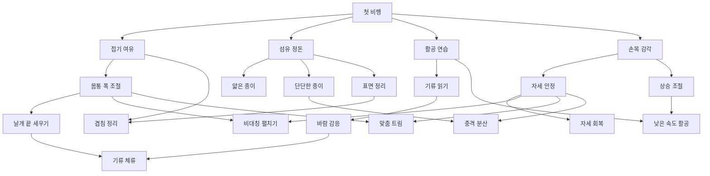

# FlyEditor 종이 접기와 비행 성장 설계

설계 버전 0.1 · 2026년 11월 4일 · PC · Unity 6000.5.3f1 · 1920×1080

3D에서 한 장의 종이를 접고, 그 기체를 그대로 2.5D 공간에서 날린다. 누르는 동안 상승하고 놓으면 하강한다. 반복 비행의 보상으로 연결형 업그레이드를 구매한다. 핵심 성취는 직접 바꾼 모양이 조작감과 도달 가능한 길을 바꾸는 경험이다.

이 문서의 접기 제한, 계수, 비용과 해금 순서는 첫 구현에 사용할 제안값이다. 실제 접기 메시·충돌·바람·사람의 조작으로 검증된 밸런스 수치는 아니다. 설명 중 비행 특성의 인과관계는 게임 규칙이며 실제 종이비행기 성능을 예측하는 공학 모델이 아니다.

## 1. 제작과 성장의 역할

- 형태는 기체의 성격을 만든다. 넓은 날개는 수동 활공, 좁고 뾰족한 기체는 속도 유지에 강점을 가진다.
- 업그레이드는 효율과 만들 수 있는 형태를 확장한다. 기체의 면적·대칭·무게중심을 임의의 능력치로 덮어쓰지 않는다.
- 조작은 속도를 고도로, 고도를 속도로 교환하며 길을 선택하는 역할이다.
- 전체 업그레이드를 구매해도 형태와 종이 재질의 장단점이 남는다. 같은 보정은 합산하고 지정한 상한을 지킨다.
- 던지기에는 별도의 정밀 타이밍 게이지를 넣지 않는다. 완성 확인 후 클릭하면 동일한 초기 자세로 출발한다. 초기 속도는 형상·종이·연구로 결정한다.
- 마음에 드는 기체는 바로 재도전할 수 있다. 재접기는 의무가 아니며 결과 화면에서 선택한다.

## 2. 종이 접기의 기본 규칙

### 2.1 한 장의 종이와 자유도의 범위

기본 종이는 가로 210mm, 세로 297mm 직사각형이다. 로컬 X는 좌우, Z는 기수 방향, Y는 종이 위쪽이다. 기수 방향은 +Z로 고정하며 중앙 기준점과 중심선 X=0을 표시한다.

첫 버전의 자유도는 `접는 선의 위치 + 방향 + 접을 쪽 + 최종 몸통 폭 + 날개 펼침각`이다. 자유 접기 한 번은 선택한 쪽의 겹친 종이 전체를 직선 기준으로 180도 접는다. 마지막에 몸통을 접고 날개를 펼쳐 3D 비행 형태를 만든다. 개별 안쪽 층을 꺼내는 접기, 곡선 접기, 찢기, 자르기, 구멍 뚫기, 젖은 종이 변형은 확장 범위다.

이 방식은 평면에서 접기 이력을 계산하고 3D로 접히는 모습을 보여주므로, 종이 전체의 실시간 연체 물리를 매 프레임 계산할 필요가 없다.

### 2.2 기본 제공 기능

| 기능 | 처리 |
|---|---|
| 접기선 | 종이 위에서 왼쪽 버튼 드래그로 두 점 지정. 화면 좌표를 종이 작업 평면으로 투영 |
| 접을 면 | 선을 정한 뒤 한쪽 영역 클릭. 이동 영역과 접힌 결과를 반투명 미리보기 |
| 확정 | Enter 또는 확인 버튼. 한 번에 약 0.35초 동안 힌지 회전 연출 |
| 취소 | Escape. 확정 전 상태로 복귀하며 횟수를 소비하지 않음 |
| 되돌리기·다시 실행 | Ctrl+Z / Ctrl+Y. 대칭 한 쌍은 한 묶음으로 되돌림 |
| 대칭 보조 | 기본 켬. 중심선에 반사된 접기를 함께 제안. 자유롭게 끌 수 있음 |
| 정렬 보조 | 선택형 5도 각도·2mm 위치 스냅. 항상 무료. Shift로 일시 해제 |
| 카메라 | 오른쪽 드래그 회전, 가운데 드래그 이동, 휠 확대. 접기 좌표는 카메라와 독립 |
| 설계 저장·복제 | 무료. 종이 종류가 잠겨도 설계 초안 저장은 가능 |
| 시험비행 | 무료. 조건과 조작을 고정한 비교 모드. 재화·기록 보상 없음 |

접기선을 드래그하는 동안 기체를 회전시키지는 않는다. 카메라 조작이 시작되면 미확정 선은 유지하되 종이 조작 입력을 잠근다. UI 위 클릭은 비행·접기 입력으로 전달하지 않는다.

### 2.3 접기 제한과 예외

| 항목 | 제안 기준 |
|---|---|
| 자유 접기 | 기본 8회, F1 1단계 10회, 2단계 12회 |
| 대칭 접기 | 실제 두 접기를 사용하므로 2회 소비. 한쪽만 가능한 경우 전체를 취소 |
| 최종 몸통·날개 펼치기 | 필수 조립 단계이며 자유 접기 횟수를 소비하지 않음 |
| 최소 이동 면적 | 겹친 면을 포함한 원래 종이 면적의 2% 이상 |
| 기준점 | 중앙 기준점이 접기선 위에 있거나 고정되는 쪽에 있어야 함. 종이 전체를 뒤집어 이동시키는 동작 방지 |
| 최대 겹침 | 한 위치에서 16겹. 초과하는 접기는 미리보기에서 거절 |
| 기하 정밀도 | 계산 좌표는 0.1mm 격자에 양자화. 화면 표시 반올림값으로 판정하지 않음 |
| 퇴화 면 | 면적 0에 가까운 조각·0 길이 접기선은 거절. 원래 종이 면적을 삭제하지 않음 |
| 지오메트리 한도 | 첫 목표 8,000정점 / 16,000삼각형. 초과 예상 시 적용 전 거절하고 이전 상태 유지 |

종이끼리 최종적으로 포개지는 것은 정상이다. 접기 연출 중의 영 두께 면 교차는 시각적으로 처리하고, 확정 시 레이어 순서를 저장한다. 자기 관통과 종이 두께를 물리 시뮬레이션으로 푸는 기능은 첫 버전에 포함하지 않는다. 화면에는 겹침을 알아볼 수 있는 미세한 두께만 표현한다.

모양이 아직 날 수 없는 중간 단계도 접기와 초안 저장은 허용한다. 완성 검사에서 수정할 위치를 강조하며 날리기만 비활성화한다.

### 2.4 완성 조건

1. 종이가 하나로 연결되어 있고 원래 면적이 보존되어야 한다.
2. 최종 몸통 기준선 주변에 앞뒤로 연결된 몸통을 만들 수 있어야 한다. 중앙 폭 영역의 연속 구간이 기체 길이의 60% 이상이어야 한다.
3. 최종 투영 유효 날개 면적이 원래 종이 면적의 12% 이상이어야 한다.
4. 왼쪽과 오른쪽에 각각 원래 면적의 4% 이상인 연결된 날개가 있어야 한다.
5. 횟수·겹침·지오메트리 한도를 만족해야 한다.

형태의 대칭이나 무게중심이 나쁘다는 이유만으로 비행을 금지하지 않는다. 해당 특성은 성능과 설명에 반영한다. 잘못된 모양을 자동으로 좋은 모양으로 교체하지 않는다.

### 2.5 몸통 접기와 날개 펼치기

자유 접기를 마치면 중앙선과 양쪽 날개 뿌리에 세 개의 긴 기준 접힘을 표시한다. 플레이어는 안내된 드래그로 몸통 접기와 좌우 날개 펼침을 완료한다. 이 과정의 결과를 생략하고 싶으면 동일 결과의 빠른 완성을 제공한다.

- 몸통 반폭 b는 기본 `0.06 × 최초 종이 폭 W0`이다. F2 구매 후 `0.04~0.10 × W0`에서 조절한다.
- 날개 상반각은 좌우 함께 `0~20도`, 기본 8도다. F4 구매 후 좌우를 각각 조절할 수 있다.
- F3 구매 후 각 날개의 바깥쪽 15% 구간을 추가로 `0~25도` 세울 수 있다. 정해진 끝단 힌지 하나를 쓰며 자유 접기 횟수는 추가 소비하지 않는다.
- 펼침각을 바꾸면 실제 날개 정점도 바뀌며, 능력치만 변경하지 않는다.
- 다시 자유 접기로 돌아가면 최종 조립만 역변환한다. 자유 접기 이력은 보존한다.

구현 기준: 평면에서 접힌 종이를 X=0, X=±b에서 분할한다. 중심선은 몸통 아래쪽, ±b는 날개 뿌리가 되도록 중앙 띠를 접고 바깥 면을 펼친다. 각 패널은 강체 변환하여 원래 길이·면적을 유지한다. 최종 중앙 몸통은 포개질 수 있다. 편집 단계의 중심선과 최종 비행의 전방축은 고정 대응한다.

## 3. 접힌 모양의 성능 판정

### 3.1 평가 시점과 기본 원칙

접기·펼침·종이 변경 확정 후에만 전체 형상을 평가하고 결과를 캐시한다. 드래그 미리보기는 낮은 해상도의 예상치이며 확정 후 정확한 값으로 갱신한다. 비행 중에는 캐시한 계수를 사용한다.

- 면의 합집합으로 바람을 받는 면적을 계산한다. 포개진 날개 면적을 층수만큼 중복 가산하지 않는다.
- 질량은 원래 삼각형 면적×종이 밀도의 합이다. 접어도 질량은 유지되고 질량 중심의 위치만 달라진다.
- 비행계수에서 사용하는 좌표·특성 추출·양자화 버전을 저장한다. 같은 버전·같은 설계·같은 입력은 같은 결과를 내야 한다.
- 길이·폭의 측정에서는 투영 면적의 중앙 98% 범위를 사용해 아주 작은 돌출점이 기체 크기를 과장하지 않게 한다.

### 3.2 일곱 가지 측정값

`clamp01(x)`는 x를 0~1로 제한한다. A0는 최초 종이 면적, Aw는 최종 몸통을 제외한 양쪽 날개의 상면 투영 합집합 면적이다. 좌우 날개가 겹치는 부분도 한 번만 센다.

| 기호 | 계산 | 플레이어가 만드는 차이 |
|---|---|---|
| A 날개 면적 | `clamp01((Aw/A0 - 0.12) / 0.43)` | 넓으면 침하량 감소·기류 효과 증가, 속도 저항·반응 시간 증가 |
| R 날개 비율 | `clamp01(((span²/Aw) - 1) / 4)` | 같은 면적에서 좌우로 펼쳐진 날개는 침하량 감소 |
| T 기수 수렴도 | `clamp01(1 - Wfront/max(Wmiddle, 0.01W0))` | 뾰족한 기수는 초기 속도·저항에 유리 |
| S 좌우 대칭 | 왼쪽 날개를 중심선 반사한 영역과 오른쪽 날개의 교집합 면적 / 합집합 면적 | 낮을수록 반응 지연·작은 흔들림·저항 증가 |
| B 무게중심 균형 | `clamp01(1 - abs(c - 0.55) / 0.25)` | 앞뒤 길이에서 55% 부근에 질량 중심이 오면 조작이 안정적 |
| D 날개 세움 | `clamp01(면적 가중 평균 상반각 / 20도)` | 위로 세운 날개는 흔들림 감소. 투영 면적 감소는 A에 따로 반영 |
| O 겹침 비율 | `clamp01(1 - Uf/A0)`; Uf는 최종 몸통 조립 전 평면 합집합 면적 | 여러 겹으로 모인 면은 바람받이 면적을 늘리지 않고 소량의 저항을 추가 |

Wfront는 기수에서 뒤로 10~30% 구간의 평균 투영 폭, Wmiddle은 40~60% 구간의 평균 폭이다. c는 꼬리=0, 기수=1로 정규화한 질량 중심 위치다. S는 최종 펼침각까지 반영한다. B=0도 비행 불가를 뜻하지 않는다.

### 3.3 형태에서 비행계수로

아래는 기본 종이 기준이다. Δ=1-S, 각 노드의 구매 단계는 `L_노드ID`, 미구매는 0이다. X 노드는 0/1이다. 재질별 보정은 다음 절의 해당 항목에 곱한다.

```text
초기 속도 v0 = 10 × (1 + 0.12T - 0.08A) × (1 + 0.03 L_C1)          [m/s]
저항 d = 0.006 × (1 + 0.35A + 0.25Δ - 0.15T
                   + 0.20O × (1 - 0.30 X4)) × (1 - 0.03 L_M4)      [1/m]
기본 침하 s = 0.25 × (1 - 0.35A - 0.15R + 0.15Δ)
                     × (1 - 0.04 L_G1)                            [m/s]
반응 시간 τ = (0.25 + 0.20A + 0.15Δ + 0.10(1-B))
                     / (1 + 0.05 L_C2)                            [s]
흔들림 진폭 J = clamp(4Δ + 2(1-B) - 1.5D, 0, 5)                    [degree]
내구도 H = 100 × (1 + 0.05 L_M1)
기류 배율 U = 1 + 0.05 L_G3 + 0.10A × X3
```

표시값은 초기 속도, 활공, 반응, 안정성, 내구도로 요약한다. 절대적인 종합 등급이나 최적 기체 별점은 제공하지 않는다. 이전 저장본과 비교해 가장 큰 두 변화와 그 원인만 강조한다. 예: `날개가 넓어져 침하 감소 / 전진 저항 증가`.

### 3.4 종이 재질

해금한 종이는 무제한으로 사용한다. 기체를 잃어도 종이·설계는 사라지지 않는다.

| 재질 | 밀도 | 초기 속도 | 저항 | 침하 | 반응 시간 | 내구도 | 기류 배율 |
|---|---:|---:|---:|---:|---:|---:|---:|
| 기본 | 1.00 | 1.00 | 1.00 | 1.00 | 1.00 | 1.00 | 1.00 |
| 얇은 | 0.80 | 0.98 | 1.05 | 0.88 | 0.85 | 0.75 | 1.12 |
| 단단한 | 1.25 | 1.04 | 1.08 | 1.12 | 1.10 | 1.30 | 0.90 |

밀도는 질량·무게중심 계산에 사용한다. 비행식은 단위 질량당 에너지 기준이며 재질의 플레이 차이는 표의 보정으로 표현한다. 실제 종이의 재료 물성을 복원한 수치는 아니다.

## 4. 2.5D 비행 처리

### 4.1 기본 조작

- 처음 클릭은 발사 전용이다. 버튼을 한 번 놓은 뒤에 상승 입력을 받는다. 발사 클릭 때문에 의도하지 않은 연속 상승이 발생하지 않는다.
- 왼쪽 버튼을 누르면 목표 피치 +8도, 놓으면 -2도다. 상승 버튼을 연타할 필요가 없다.
- X1을 해금하면 출발 전 트림 -2~+2도를 선택한다. 상승 목표는 `8+trim`, 놓음 목표는 `min(0, -2+trim)`이다.
- 현재 피치는 목표에 `1-exp(-dt/τ)` 비율로 접근한다. 형상 흔들림 `J sin(2π×0.6t + phase)`은 평활화 전 목표 피치에 더하며 phase는 재현 가능한 시드에서 얻는다. 자동 저속 회복 중에는 흔들림 목표를 덮어쓴다.
- 좌우 깊이축은 이동하지 않는다. 기체는 접힌 3D 모델을 사용하고, 카메라는 약간 비스듬한 측면에서 날개와 몸통을 함께 보여준다.

### 4.2 속도와 높이의 계산 기준

검증용 초깃값은 높이 3m, 속도 v0, 피치 0도다. 위치·속도는 하나의 비행 계산기가 소유하고 Rigidbody 물리와 중복 적분하지 않는다.

```text
g = 3 m/s²                                  # 게임용 중력 계수
slow = clamp01((5 - v) / 3.2)
sink = 기본 침하 s + 0.8 × (1 - 0.20 G4) × slow²  # 저속일수록 추가로 가라앉음
drag = d × (1 - 0.04 L_C3) if θ > 0 else d

dv/dt = -g sin(θ) - drag × v² + windForward
dh/dt = v sin(θ) - sink + windUp
dx/dt = v cos(θ)
```

속도 상한은 25m/s이며 초과 에너지는 버린다. 바람은 구역 안에서만 적용되는 외부 에너지다. G3·X3·재질의 기류 보정은 windUp에 적용하고, 순풍 windForward에는 중복 적용하지 않는다. 수직 기류 속도 상한은 2.5m/s, 순풍 가속 상한은 1.5m/s²부터 시작한다. 수치와 기류 길이는 실제 맵에서 조정한다.

바람·충돌이 없는 경우 `E=0.5v²+gh`의 변화는 `dE/dt=-drag×v³-g×sink ≤ 0`이다. 입력만 반복하여 무한히 에너지를 만들 수 없다. 상승 연구는 저항을 줄이며 중력에 쓰는 비용을 삭제하지 않는다.

저속 추가 침하가 없으면 계속 누른 상태에서 너무 오래 떠 있는 문제가 생기므로 반드시 함께 적용한다. 최종 Unity 적분기는 dt 0.02s를 시작점으로 하고, 실제 입력·기류·충돌을 포함해 다시 검사한다.

### 4.3 회복과 종료

- 속도 3.2m/s 미만이 0.6초 유지되면 자동 자세 회복 상태로 전환한다. G4는 이 기준을 바꾸지 않고 저속 추가 침하만 20% 줄인다.
- 자동 회복은 목표 피치 -12도를 사용한다. 속도가 기준+0.5m/s 이상이 되면 현재 버튼 상태에 맞춰 복귀한다. 상태 전이와 저속 타이머는 한 경로에서 처리한다.
- 속도 부족 자체는 즉시 실패가 아니다. 낮아지며 다시 속도를 얻을 기회를 준다.
- 지면 접촉 또는 내구도 0에서 비행을 종료한다. 지면 착지는 기록을 정상 정산한다.
- 약한 충돌은 HP 35·현재 속도 15%, 중간 충돌은 HP 60·속도 30%, 강한 충돌은 HP 100·속도 45%를 잃는다. 강도 구간은 물체의 전방 표면 법선에 대한 접근 속도 3m/s·7m/s 경계로 분류한다.
- 접촉 직후 1초는 같은 충돌 사건의 재피해를 막는다. 물체에서 분리되는 처리는 계속하며 보호시간을 벽 통과 기능으로 사용하지 않는다.
- 기본 종이는 약한 충돌 두 번을 견딘다. X2는 약한 충돌 HP 피해만 0.8배로 줄인다.
- C4는 Space 1회로 충돌에 의한 자세 교란만 0.25초에 걸쳐 제거한다. 입력에 의한 정상 기수 변화나 형상의 기본 성격은 지우지 않는다. 속도·고도·HP는 생성하지 않는다.
- 충돌 판정은 비행 평면으로 투영한 기체의 길이·높이 범위로 구성하고 가장자리 약 15%를 관대하게 잡는다. 배경의 깊이축 물체는 충돌 대상이 아니다.

## 5. 웹 구조 업그레이드

### 5.1 공통 규칙

화면 중앙은 무료 `첫 비행`이고 네 방향에 접기·재질·활공·조종 연구를 둔다. 처음에는 네 가지 입문 노드가 열려 있다. 각 노드에는 효과, 현재 단계, 다음 비용, 필요한 선행 단계가 표시된다.

모든 선행 조건은 AND다. 적힌 단계 이상을 구매해야 해당 노드의 첫 단계를 살 수 있다. 다단계 노드는 현재 단계의 다음 단계만 산다. 최대치에서는 구매 입력을 막는다. 구현용 원본 데이터는 [upgrade-nodes.json](upgrade-nodes.json)이다.

| ID | 노드 | 단계별 연구점 비용 | 선행 조건 | 효과 |
|---|---|---|---|---|
| F1 | 접기 여유 | 45 / 120 | 없음 | 자유 접기 +2회씩, 최대 12회 |
| F2 | 몸통 폭 조절 | 100 | F1 1단계 | 몸통 반폭 0.04~0.10W0 선택 |
| F3 | 날개 끝 세우기 | 180 | F2 | 바깥 날개 15%를 0~25도 세우는 조립 기능 |
| F4 | 비대칭 펼치기 | 220 | F2 + C2 1단계 | 좌우 날개 펼침각 개별 조절 |
| M1 | 섬유 정돈 | 30 / 65 / 130 | 없음 | 최대 내구도 +5%씩, 총 +15% |
| M2 | 얇은 종이 | 90 | M1 1단계 | 얇은 종이 재질 해금 |
| M3 | 단단한 종이 | 90 | M1 1단계 | 단단한 종이 재질 해금 |
| M4 | 표면 정리 | 100 / 180 / 300 | M1 2단계 | 저항 계수 -3%씩, 총 -9% |
| G1 | 활공 연습 | 30 / 65 / 130 | 없음 | 기본 침하 -4%씩, 총 -12%. 저속 추가 침하는 그대로 |
| G2 | 기류 읽기 | 90 | G1 1단계 | 접근 기류 방향을 최대 1.5초 먼저 표시 |
| G3 | 바람 감응 | 110 / 190 / 320 | G2 | 상승기류 효과 +5%씩, 총 +15% |
| G4 | 낮은 속도 활공 | 230 | G1 2단계 + C3 1단계 | 저속 추가 침하 항을 20% 감소. 회복 진입 속도는 동일 |
| C1 | 손목 감각 | 30 / 65 / 130 | 없음 | 초기 속도 +3%씩, 총 +9% |
| C2 | 자세 안정 | 75 / 130 / 220 | C1 1단계 | 자세 반응률 +5%씩. 반응 시간은 1.15까지 나눔 |
| C3 | 상승 조절 | 100 / 180 / 300 | C1 1단계 | 상승 자세에서 저항 -4%씩, 총 -12% |
| C4 | 자세 회복 | 140 | C2 1단계 | Space로 충돌 자세 회복, 비행당 1회 |
| X1 | 맞춤 트림 | 240 | F2 + C2 1단계 | 출발 전 기본 피치 -2~+2도 조절 |
| X2 | 충격 분산 | 280 | M3 + C2 2단계 | 약한 충돌 HP 피해 20% 감소 |
| X3 | 기류 체류 | 320 | F3 + G3 1단계 | 기류 효과 추가 +10%×A. G3와 합산 최대 +25% |
| X4 | 겹침 정리 | 320 | F1 2단계 + M4 2단계 | 겹침 O로 인한 저항 항만 30% 감소 |

M4와 C3는 전체 저항·상승 중 자세 저항이라는 서로 다른 단계에 적용한다. 둘 다 최대일 때 상승 중 해당 배율은 `0.91×0.88=0.8008`이다. 전체 공기 저항 21% 감소로 더해서 계산하지 않는다. 재질 배율은 별도다.



그래프의 연결은 선행 관계만 나타낸다. 정확한 필요 단계는 표와 JSON을 따른다. 웹 화면에서 선행 단계를 클릭하면 해당 노드로 이동할 수 있게 한다.

### 5.2 보상과 구매 처리

연구점은 `floor(전방 최대 도달거리/5m) + 2×수집한 종이 조각 수`다. 거리는 누적 이동 경로가 아니라 시작점에서의 최대 전방 변위다. 위아래로 반복 움직여 거리를 늘릴 수 없다. 각 주요 구간 최초 도달 시 20점을 한 번만 추가한다.

수익 예시: 60m·조각 4개는 20점, 220m·조각 6개는 56점, 600m·조각 8개는 136점이다. 이는 경제 설명용 입력이며 현재 게임에서 측정한 플레이 기록은 아니다. 최초 구매 30점은 초반 2~3회의 정상 시도에서 가능하도록 맵을 조정한다. 5m도 도달하지 못한 첫 3회에 한해 안내와 함께 보조 연구점 5점을 각각 지급한다. 이후 반복 지원은 없다.

모든 20개 노드를 끝까지 구매하는 비용은 5,345점이다. 총 플레이 시간이나 실제 해금 속도는 아직 정하지 않는다. 기류·장애물 배치와 실제 기록 분포를 확인한 뒤 비용을 조정한다.

- 유효 노드 ID, 다음 단계, 모든 선행 단계, 잔액을 확인한 뒤 비용 차감과 단계 상승을 하나의 저장 처리로 반영한다.
- 비행 보상은 runId별 한 번만 지급한다. 앱 종료 후 결과 재표시로 중복 지급하지 않는다.
- 중도 포기는 확인 후 pending 보상을 버리고 작업대로 돌아간다. 앱 강제 종료는 마지막 비행 저장 상태에서 복구하며 자동 보상하지 않는다.
- 연구점 재분배는 작업대에서 무료로 가능하다. 실제 지불한 비용을 돌려주며, 선행 조건이 깨진 하위 노드도 연쇄 환불한다. 환불될 노드와 금액을 미리 보여준다.
- 해금이 취소되어도 설계 파일은 삭제하지 않는다. 해당 재질·접기 수·조립 기능이 다시 열릴 때까지 그 설계의 출발만 막고, 복제해 기본 규칙에 맞게 수정할 수 있게 한다.
- 되돌리기, 대칭 보조, 설계 저장, 기본 기류 시각화는 구매로 잠그지 않는다.

## 6. 플레이어에게 보여줄 피드백

접기 화면에는 현재 기체와 이전 저장본의 실루엣을 함께 비교하고, 실제 계산값에서 가장 큰 변화 두 개를 설명한다. 근거가 없는 성공 예측이나 최고 비행거리 예측은 표시하지 않는다.

결과 화면은 거리·연구점 외에 상승 시간, 저속 회복 진입 횟수, 충돌 횟수, 기류 체류시간을 보여준다. 예를 들어 저속 회복이 반복되면 `상승을 오래 유지해 속도가 부족했어요`를 표시한다. 면적 변경이 실제로 있었을 때만 `날개를 넓혀 기본 침하가 줄었어요`를 표시한다.

비행기마다 이름, 작은 3D 미리보기, 접기 이력, 최고 기록, 당시 종이·업그레이드 스냅샷을 저장한다. 이전 최고 기록과 현재 기록의 업그레이드가 다르면 직접적인 형태 성능 비교로 표시하지 않는다.

무료 시험비행은 동일 코스·동일 바람 시드·동일 조작 기록으로 A/B를 번갈아 재생한다. 첫 제공 조작은 `2초 상승 / 4초 활공 반복`이며 직접 기록한 조작도 재생할 수 있게 확장한다. 시험비행에는 조각·최초 구간 보상과 공식 최고 기록을 적용하지 않는다.

## 7. 대표 형태 비교와 수치 검사

아래 수치는 접힌 메시에서 측정한 값이 아니라, 수식이 서로 다른 특성을 만드는지 검사하기 위한 정규화 입력이다. 실제 제작 가능한 메시가 같은 특징값에 도달하는지는 접기 시제품에서 따로 검증한다.

| 대표 입력 | A | R | T | S | B | D | O |
|---|---:|---:|---:|---:|---:|---:|---:|
| 넓은 활공형 | 0.85 | 0.75 | 0.25 | 1.00 | 0.85 | 0.60 | 0.20 |
| 좁은 속도형 | 0.30 | 0.25 | 0.90 | 1.00 | 0.75 | 0.25 | 0.50 |
| 안정 균형형 | 0.55 | 0.45 | 0.55 | 1.00 | 0.95 | 0.90 | 0.35 |
| 비대칭 실험형 | 0.55 | 0.45 | 0.55 | 0.65 | 0.65 | 0.40 | 0.35 |

오프라인 식 검사의 조건은 기본 종이·업그레이드 0·높이 3m·바람 및 충돌 없음·dt 0.01초다.

| 대표 입력 | 놓기만 할 때 거리 | 2초 상승·4초 활공 반복 거리 | 계속 누를 때 거리 |
|---|---:|---:|---:|
| 넓은 활공형 | 58.63m | 115.85m | 108.36m |
| 좁은 속도형 | 54.07m | 143.95m | 130.40m |
| 안정 균형형 | 55.48m | 127.21m | 122.09m |
| 비대칭 실험형 | 55.32m | 119.23m | 112.29m |

이 계산에서는 넓은 활공형이 수동 활공에 유리하고, 좁은 속도형이 주기적인 조작에서 멀리 간다. 네 경우 모두 계속 누르기보다 상승·활공을 교대하는 편이 더 멀리 간다. 이 결과는 모든 입력에서의 최적 전략 증명이나 실제 게임 성능 검사가 아니다.

연결 그래프 20개 노드의 순환·존재하지 않는 선행 조건·불가능한 필요 단계, 768개 형상 경계·종이·강화 조합의 계수 유효성, 12개 무풍 비행의 에너지 비증가를 검사한다. 균형형 주기 조작의 dt 0.02초와 0.005초 거리 차이는 약 0.079%다. 결과 원본은 [verification-results.json](verification-results.json), 실행은 `python Docs/Design/verify_design.py`다.

## 8. FSM과 저장 데이터

### 8.1 상태

- 전체 진행: `Workbench -> Folding -> Assembly -> FlightReady -> Flying -> Result -> Workbench/Upgrade`.
- 접기: `Idle -> DrawingLine -> ChoosingSide -> Preview -> Validating -> FoldingAnimation -> Idle`. 실패는 직전 미리보기로 복귀한다. 애니메이션 중 새 접기 입력은 막는다.
- 비행: `Launching -> Glide/Climb -> LowSpeedRecovery -> Glide/Climb -> Landed/Crashed`. 충돌 교란은 별도 수치이며 상태를 중복 생성하지 않는다.
- 비행 종료와 보상 확정은 단 한 번 실행한다. Pause는 입력과 시뮬레이션 시간을 함께 멈추고 종료 처리를 진행하지 않는다.

상태는 Enter/Tick/FixedTick/Exit로 역할을 나눈다. 입력은 Tick에서 읽고, 비행과 충돌 상태 변경은 FixedTick의 일관된 시점에 적용한다. 같은 상태 재진입과 콜백 안의 연쇄 전이는 방지한다.

### 8.2 저장 레코드

```text
Blueprint
  schemaVersion, blueprintId, name, createdAt, geometryVersion
  paperId, originalWidthMm, originalLengthMm
  foldOperations[{sequence, creaseA, creaseB, movingSide, mirrorGroup, angle:180}]
  assembly{bodyHalfWidth, leftDihedral, rightDihedral, leftTipAngle, rightTipAngle, trim}
  geometryHash, featureVersion, cachedFeatures{A,R,T,S,B,D,O}
  bestRunId, thumbnailReference

Progress
  schemaVersion, revision, researchPoints
  nodeRanks, purchaseLedger[{nodeId,rank,cost,transactionId}]
  firstReachedZones, beginnerSupportCount, paidRunIds

Run
  runId, status, blueprintHash, modelVersion, upgradeSnapshot, paperSnapshot
  courseSeed, inputRecord, simulationTick, currentFlightState
  position, speed, pitch, hp, lowSpeedTimer, collisionDisturbance, contactGraceTimer
  recoverySkillRemaining, swayPhase, activeContactIds
  maxForwardDistance, collectedItemIds, collisionCount, recoveryCount
  pendingReward, rewardCommitted
```

재구성한 geometryHash가 다르거나 버전이 바뀌면 캐시를 다시 계산한다. 저장 시 임시 파일 작성 후 교체하고 이전 정상본 한 개를 보존한다. 메시·미리보기는 파생 데이터이며 접기 이력과 설정이 원본이다. 완료 후에는 실행 중인 비행의 업그레이드 스냅샷을 변경하지 않는다.

## 9. 구현 순서와 검수 기준

### 9.1 첫 시제품

접기선·한쪽 선택·180도 접기·대칭·되돌리기, 고정 몸통 조립과 연결 날개 펼침, 표준 재질, 캐시한 형상계수, 기본 비행·충돌·상승기류, 설계 저장·고정 조건 시험비행을 먼저 구현한다.

시제품의 연구 노드는 F1, F2, M1, M2, M3, G1, G2, C1, C2, C4, X1의 11개다. 이 범위의 선행 조건은 모두 시제품 안에 포함된다. 순서상 고정 몸통·단일 재질 비행이 확인된 뒤 F2·M2·M3·X1을 켠다. 나머지 9개는 검증 후 확장한다.

### 9.2 반드시 확인할 것

1. 동일 접기 이력의 재생·저장·복원 결과에서 geometryHash와 형상 특성이 일치한다.
2. 원래 종이 면적·질량 보존 오차가 양자화 기준 내에 있고, 겹친 면적을 양력 면적으로 중복 합산하지 않는다.
3. 대칭 접기 두 번째 동작 실패 시 첫 번째만 남지 않는다. Undo/Redo의 묶음·횟수·메시가 함께 복구된다.
4. 횟수·겹침·정점 한도 초과는 확인 전 안내하며 설계를 손상시키지 않는다.
5. 각기 다른 실제 접기 세 종류에서 육안 형태와 수치 차이를 설명할 수 있다. 작은 비대칭도 즉시 실패를 만들지 않는다.
6. 무풍·무아이템에서 반복 입력으로 에너지가 늘지 않고, 저속 회복은 진입·탈출 경계에서 매 프레임 왕복하지 않는다.
7. 실제 플레이에서 첫 기록은 목표 15~30초 정도로 조정한다. 놓기만 할 때의 짧은 비행도 정상 정산하고 즉시 재도전할 수 있다.
8. 약한 충돌 두 번을 견디며, 한 장애물 접촉으로 여러 번의 피해가 중첩되지 않는다.
9. 노드 구매·재분배·게임 종료 중단 후 잔액과 단계가 일관되고, 동일 runId의 보상이 중복 지급되지 않는다.
10. 업그레이드 최대치에서도 서로 다른 형태의 장단점이 남고, 무료 시험비행이 일반 보상을 지급하지 않는다.
11. 접기 확정의 목표 지연은 일반 기체 100ms 이하, 복잡한 기체 250ms 이하부터 잡는다. 초과하면 처리 중 상태와 취소를 제공한다. 수치는 목표이며 아직 측정하지 않았다.
12. 비행 루프의 지속적인 GC Alloc 0B/frame을 목표로 캐싱·사전 할당을 적용한다. 실제 Unity Profiler 기록으로 확인한다.

### 9.3 이 게임의 차별성을 확인하는 질문

플레이어가 결과를 보고 `업그레이드를 사자`뿐 아니라 `날개를 넓혀보자`, `같은 모양에 얇은 종이를 써보자`, `저 창문을 지나가려면 반응이 빠른 기체로 바꾸자`라는 행동을 선택하는지 확인한다. 새 기능은 기체의 모습과 사용 방법 중 적어도 하나를 바꿔야 한다. 거리 숫자와 수익 배율만 커지는 노드는 중심 성장으로 삼지 않는다.

## 참고 맥락

- 사용자 합의: 직접 종이를 접는 3D 제작, 완성한 기체의 2.5D 비행, 누르기 상승·놓기 하강, 낮은 난이도, 연결형 업그레이드, FSM 개발 원칙.
- [RippleLoop 참고 영상 3분 19초](https://www.youtube.com/watch?v=USEmCjnKLTw&t=199s)와 [16분 46초](https://www.youtube.com/watch?v=USEmCjnKLTw&t=1006s): 반복 도전과 연결된 성장 화면의 참고. 이 설계의 접기 규칙·계수·노드 비용은 FlyEditor용 제안이다.
