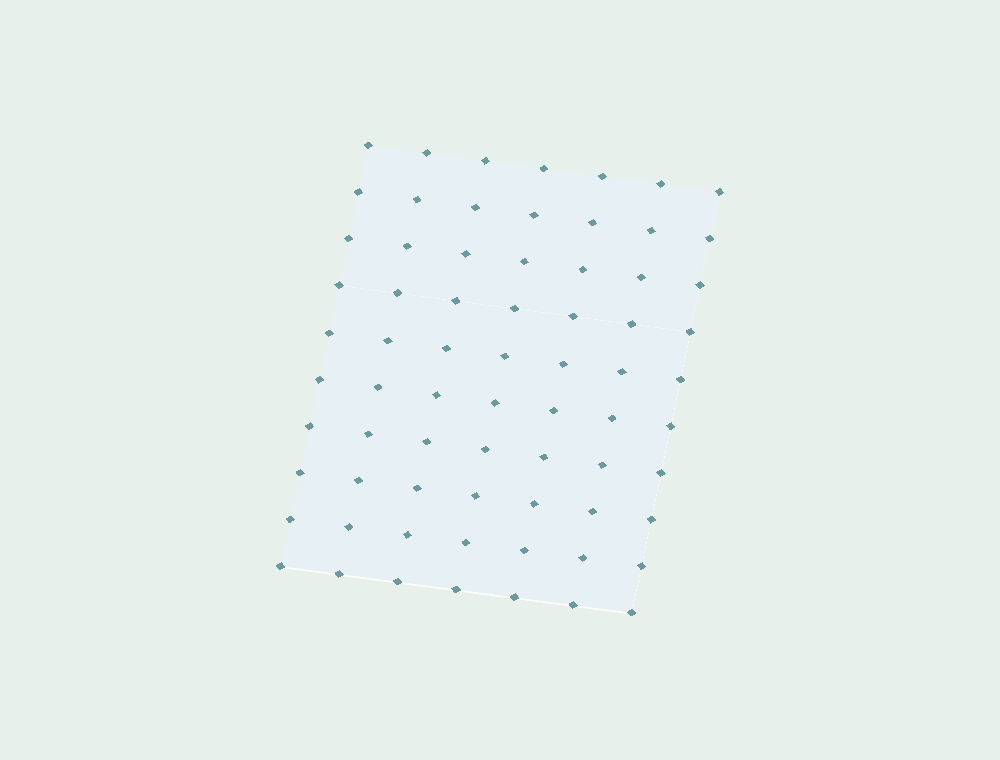
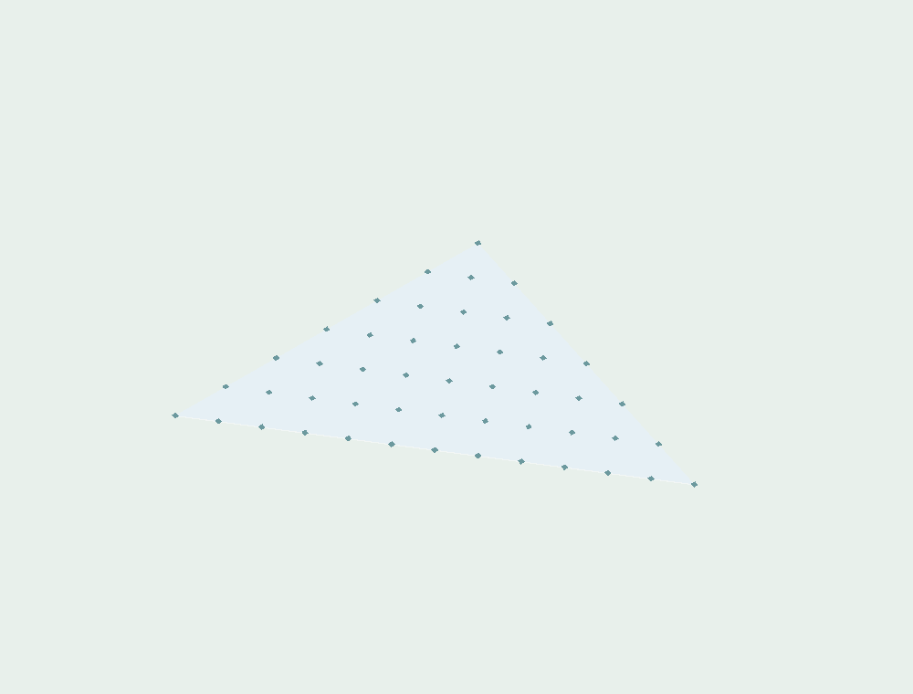
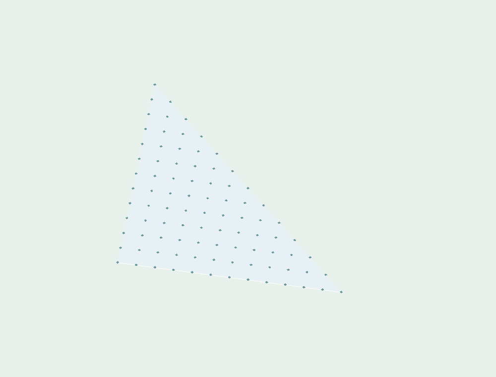

> 과거 실행 기록: 예비 접기를 포함한 경로입니다. 게임 적합성 판단과 보강 우선순위는 [수정된 보고서](README.md)를 따릅니다.

# 종이접기 5종 도안 시도 기록

검증일: 2026-11-10 · Unity 6000.5.3f1 · 한 변 13점, 초기 169점 · 최대 접기 10회

**5종을 현재 엔진으로 순서대로 시도했지만 완성한 작품은 없다.** 단순 접기와 예비 접기는 진행되었고, 겹을 유지한 펼치기·주머니 눌러 펴기·여러 접힘선의 동시 변형에서 진행을 멈췄다. 실패한 경로가 있다는 사실과 모든 가능한 조작으로 불가능하다는 판단은 다르다. 이번 기록은 전자이며, 뒤 단계의 성공 여부를 추정해서 채우지 않았다.

## 검증 범위

- 공개 도안의 초기 단계 그림과 설명을 대조해 좌표를 정했다. 완성 메시를 가져오거나 종이 면을 교체하지 않았다.
- 실제 프로젝트와 동일한 `PaperSheet`, `PaperCornerPull`, `PaperInsideReverse`, `FoldMesh`, `FoldingDesk` 소스를 사용한 별도 Unity 프로젝트에서 실행했다.
- **5종 도안 시도는 엔진 API를 통한 자동 접기다.** 마우스로 도안 전체를 플레이한 테스트가 아니다. 좌표·겹 번호를 직접 지정하므로 입력 UI의 성공까지 보장하지 않는다.
- 별도로 13점 배열은 Play Mode에서 Input System 마우스 입력으로 한 변의 13점 선택/재클릭 해제, 중앙선 180° 반 접기, 되돌리기, 4점→2점 전환을 검증했다.
- 예비 접기를 펼칠 때 Undo로 대체하지 않았다. `OpeningTurns`의 한 겹/전체 겹 후보와 ±180°를 시험하고, 종이 원래 좌표에 대응하는 위치가 접기 전으로 돌아오는지 비교했다.
- 모델별 PNG는 **현재 게임의 메시 생성기로 렌더한 중간 상태**다. 완성품이나 최종 게임 UI 스크린샷이 아니다. 4점 미리보기는 커밋된 접기 기록에 포함하지 않는다.
- 기록의 `commits`는 엔진의 접기 확정 수다. 도안의 단계 번호와 같지 않다. 접었다 펴면 2회이며, 회전/뒤집기는 좌표 설명에 포함된다. 예비 접기의 산/골 방향을 별도 목표 데이터로 보존하는 시험은 하지 않았다.

## 도안 선정과 결과

아래 1~5는 이번 테스트 안에서의 학습 순서다. 사이트 간 통일된 난이도 등급이 아니다. 특히 드래곤 v2의 원문 난이도는 **Low-Intermediate**이므로 전문가용 고난도 모델로 과장하지 않는다. 기초 베이스부터 막히는 현 상태에서는 더 어려운 작품으로 바꾸기보다 이 다섯 경로를 먼저 통과시키는 것이 유용하다.

| 순서 / 모델 | 원본 도안 | 시도한 마지막 부분 | 멈춘 이유 / 검증 한계 |
|---|---|---|---|
| 1. 물폭탄 | [Origami.me, 전통 모델](https://origami.me/waterbomb/) | 웹 1~2단계의 가로·세로·양 대각선 예비 접기, 8회 확정 | 웹 3단계의 동시 눌러 접기를 4점 방식으로 시험. 일부 각도는 변형되지만 도안의 삼각 베이스를 재현하지 못함 |
| 2. 점프 개구리 | [Japan Society, 16단계 PDF](https://www.japansociety.org.uk/usercontent/3bc1ed5a28641e243974254376c82e51/Jumping-Frog-Origami-Instructions.pdf) | PDF 1~2단계 및 3단계의 접기, 4회 확정 | 3단계의 펼치기에서 원래 두 겹 직사각형으로 돌아오는 후보를 찾지 못함 |
| 3. 종이학 | [California Museum, 20단계 PDF](https://californiamuseum.org/wp-content/uploads/CAM_Uprooted_CraneInsturctions.pdf) | PDF 1~2단계, 2회 확정 | PDF 3~4단계의 주머니 벌리기·눌러 펴기를 위한 4점 후보가 생성되지 않음. 이 좌표 조합의 실패이며 다른 가능한 접기 경로까지 부정하지 않음 |
| 4. 백합 | [Origami-Fun, 14단계 PDF](https://www.origami-fun.com/support-files/origami-lily-print.pdf) | PDF 1~2단계의 예비 접기, 8회 확정 | PDF 3단계의 물폭탄 베이스에서 시험한 4점 후보가 목표 각도에 도달하지 못함. 4단계 눌러 펴기와 8단계 꽃잎 접기는 아직 미실행 |
| 5. 드래곤 v2 | [Sébastien Limet / Origami.me, 49단계](https://origami.me/dragon-advanced/) | 웹 1단계 예비 접기와 3단계, 3회 확정 | 웹 4단계의 앞쪽 한 겹 접기를 엄격한 한 면 선택으로 요청하면 `Plan`이 null. 다른 앵커/연결 범위에서는 가능한 후보가 있어 추가 판별 필요 |

## 막힌 지점의 재현 정보

좌표는 정사각형 종이의 평면 좌표 `(x,z)`, 범위 `0~11`이다. 카메라의 좌우 방향과 도안의 화면 방향이 다를 수 있다. 정확한 요청, 앵커, side, 각도는 [results.json](results/results.json)에 있다.

### 물폭탄: 여러 접힘선을 함께 움직여야 하는 단계

네 방향 예비 접기와 펼치기는 수행했다. 복원 위치 오차는 최대 약 `0.0000035`이며 면적은 약 `121`이다. 그러나 펼친 뒤에도 조각별 layer가 달라지고 면 분할이 남는다. 이는 단순한 평면 위치 복원만으로 선택·겹 순서까지 원래 상태가 되었다고 볼 수 없는 이유다.

웹 3단계에서 왼쪽 중간점 `(0,5.5)`과 중앙 `(5.5,5.5)`, 왼쪽 두 모서리를 4점 입력으로 시험했다. 앵커/선택 범위 4조합 중 2개가 생성되었고, ±45/90/135/180° 표본 중 허용 범위 안에서 성공한 포즈는 합계 2개였다. **일부 부채꼴 변형 성공을 물폭탄 베이스 성공으로 판정하지 않았다.**

### 개구리: 접힌 두 겹을 함께 펼치는 범위

가로 반 접기/펼치기 → 세로 반 접기 → 위쪽 절반의 접기까지 진행했다. 마지막 접는 축은 `z=8.25`다. 이 접힘만 펼쳐 두 겹 직사각형으로 돌아가야 한다.

한 겹/전체 겹 모드의 후보를 모두 조사했지만, 만들어진 4개 후보에서 접기 전 형상을 복원하지 못했다. 최소 원래 종이 점 위치 오차는 `5.5`였다. 허용 오차 `0.05`와 크게 달라 다른 영역까지 움직인 결과를 성공으로 받아들이지 않았다.

**우선 조사할 부분:** 한 겹과 전체 겹 사이에 있는 ‘연결된 두 겹 묶음’ 선택. 현재 한 겹 모드는 다른 겹이 움직이면 거절하고, 전체 겹 모드는 의도보다 넓은 영역을 포함할 수 있다. 이 원인은 후보 생성/연결 그래프의 추가 계측으로 확정해야 한다.

### 종이학: 주머니를 벌려 평평한 사각형으로 만드는 동작

대각선 반 접기와 삼각형의 반 접기를 진행했다. 13점 배열에서는 두 번째 축의 중앙점 `(5.5,5.5)`도 존재한다.

현재 4점 변형에 주머니의 끝/중앙/측면 점을 넣어 앵커와 범위를 8조합으로 시험했지만 생성된 후보가 0개였다. **도안 전체의 불가능 판정은 아니다.** 현재 부채꼴 연산과 이 입력 조합으로 해당 squash 동작을 재현하지 못했다는 결과다. 기존 접힘선을 90° 벌리는 동작만 성공하더라도, 양 옆의 접힘과 평탄화까지 확인하기 전에는 3~4단계 성공으로 처리하면 안 된다.

### 백합: 베이스에서 중단, 꽃잎 접기는 미검증

예비 접기 8회 후 오른쪽 중간점 `(11,5.5)`을 사용하는 4점 조합을 시험했다. 앵커/범위 4조합 중 2개가 생성되었으나, 시험한 각도 표본에서 유효한 포즈는 0개였다.

이후 도안의 눌러 펴기·꽃잎 접기·반복 패널 작업은 아직 실행하지 못했다. 이 기능들이 실제로 실패했다고 기록하지 않는다. 물폭탄과 반대쪽 후보의 차이는 관찰되었지만, 이 시험만으로 대칭 버그를 확정할 수는 없다.

### 드래곤: 하나의 앞면이 여러 패널로 나뉜 경우

다이아몬드 방향의 종이로 해석해 첫 대각선을 접었다 펴고, 다른 대각선으로 반 접었다. 웹 4단계의 앞면 끝을 올리는 축은 `x+z=5.5`다. 두 끝점은 현재 점 배열에 모두 존재한다.

가장 위 패널을 엄격한 한 면으로 지정하면 `Plan`이 null이었다. 모든 앵커와 엄격/연결 범위를 바꾼 추가 진단에서는 계획 4개, 요청 각도까지 허용된 후보 2개가 있었다. **따라서 엔진 자체가 전혀 접을 수 없다고 결론 내리면 안 된다.** 이 두 후보가 의도한 앞쪽 종이 전체만 움직이는지 검증하고 UI에 연결하는 작업이 필요하다.

정지 상태 CSV에서 앞쪽 삼각형은 layer 5와 3의 두 조각으로 나뉜다. `SamePanel`이 layer·material·frame의 일치를 요구하므로 예비 접기 후 생긴 조각들을 한 면으로 인식하지 못할 가능성이 있다. 이는 코드/데이터에 근거한 원인 후보다. 뒤쪽의 swivel·reverse·crimp 단계는 미실행이다.

## 보강 순서와 통과 조건

| 우선순위 | 보강할 것 | 통과 조건 |
|---|---|---|
| P0 | 원래 종이 면의 식별자와 화면상의 layer 순서를 분리 | 예비 접기 후 앞면이 여러 조각이 되어도 같은 의도적 면으로 선택. 다른 겹의 위치는 고정 |
| P0 | 연결된 일부 겹의 선택 및 펼치기 | 개구리 3단계의 두 겹만 함께 원위치. 접기 전/후 원래 점 대응 오차와 고정 면 변위를 검사 |
| P0 | 예비 접기 기록과 조작 이력 분리 | 펼쳐도 접힘선의 위치·산/골·인접 패널 정보 유지. Undo는 조작 취소로 별도 처리 |
| P1 | 다중 힌지의 동시 제약 해결 | 물폭탄 베이스와 종이학 주머니를 실제 도안 형상으로 완성. 허용 포즈 존재만으로 성공 처리하지 않기 |
| P1 | 10회 제한을 단계 수/형상 복잡도 예산과 분리 | 예비 접기 8회 뒤에도 도안 진행 가능. 저장/재생/되돌리기, 면 수·연산 시간·충돌 안정성까지 검증 후 상한 변경 |
| P1 | 임의 비율 기준점과 모서리 스냅 | 13개 점의 정확한 중앙은 유지하면서 필요한 1/8 등 도안 지점을 보조 선택. 격자 개수만 늘리는 방식에 의존하지 않기 |
| P2 | 꽃잎·안/밖 뒤집기·주름 접기의 연속 변형 | 백합 이후 단계, 드래곤 이후 단계에 순차 진입하여 면 길이·접합부·자기충돌·저장 복원을 검사 |
| P2 | 완성 후 물리 반응 | 물폭탄 팽창, 개구리의 탄성 점프 등은 접기 완성과 별도 시험. 이번에는 미검증 |

현재 `MaxFolds=10`이며 펼치기도 한 번으로 누적된다. 물폭탄/백합은 베이스 전에 이미 8회를 사용했다. 수치만 크게 늘리면 연결 관계나 충돌 문제가 해결되는 것은 아니므로 이번에는 제한을 임의로 풀지 않았다.

## 이번에 실제로 적용한 변경

- 한 변 14점 → **13점**, `GridIntervals=12`, 초기 전체 **169점**.
- 관련 기존 검증의 점/연결 수를 수정했다. 점 쌍 14,196개 연결 검사, 겹·되돌리기·재생 회귀 검증과 Play Mode 입력 검증을 통과했다.
- 종이접기 물리/선택 알고리즘은 이번 진단으로 완성했다고 주장하지 않는다. 위 보강 항목은 아직 구현 전이다.

## 재실행과 증거

- Unity 편집기: `Tools > FlyEditor > Validation > Origami feasibility audit`.
- 배치: `-batchmode -quit -force-d3d11 -projectPath <별도 검증 프로젝트> -executeMethod OrigamiFeasibilityAudit.Run -logFile <절대 경로>`.
- 출력 위치: 기본 `Docs/OrigamiAudit/results`, 환경변수 `FLYEDITOR_ORIGAMI_AUDIT`로 변경 가능. 같은 경로로 재실행하면 이전 기록을 덮어쓴다.
- [단계별 요청·결과·저장 레시피 JSON](results/results.json), [엔진 진단 로그](unity-origami-audit.log), [13점 검증 요약](grid13-verification.txt), [소스 해시](source-manifest.json).
- `*-panels.csv`: 정지 상태의 면/겹/좌표/원래 종이 좌표. `*-stopped.png`: 정지 시점 메시. `*-fan-preview.png`: 별도 4점 후보 미리보기.
- 로그의 ‘five attempts recorded’는 진단 실행 완료를 뜻하며 작품 5종의 완성을 뜻하지 않는다. JSON의 `completed`는 모두 false다.
- 원본 도안은 위 링크에서 확인한다. 외부 PDF/원본 도안 이미지는 저장소에 재배포하지 않았다.
