# 드래곤 실제 조작 검증 기록

진행 중. 완성으로 판정하지 않음. 원본 도안: [Jo Nakashima Dragon](https://jonakashima.com.br/wp-content/uploads/2015/07/Dragon-Jo-Nakashima.pdf). 20×20cm 정사각형 한 장을 사용하는 공개 도안이며 본 테스트는 자르기/붙이기를 사용하지 않는다. 원본 도안은 재배포하지 않는다.

도안 1~2의 준비 주름은 직접 기준점 지정으로 생략. 입력은 격리된 Unity Input System 마우스/키보드로 수행했다. 레시피를 미리 완성 형태로 교체하지 않았다. 저장본 재시작은 기록된 현재 상태를 잇기 위한 체크포인트다.

각 캡처는 실제 Unity 화면이다. 실패한 시도와 도안 해석 오류를 성공으로 세지 않는다.

## A-001 · open

open

조작: Numpad7. 좌표는 작업대 1280×900 기준.

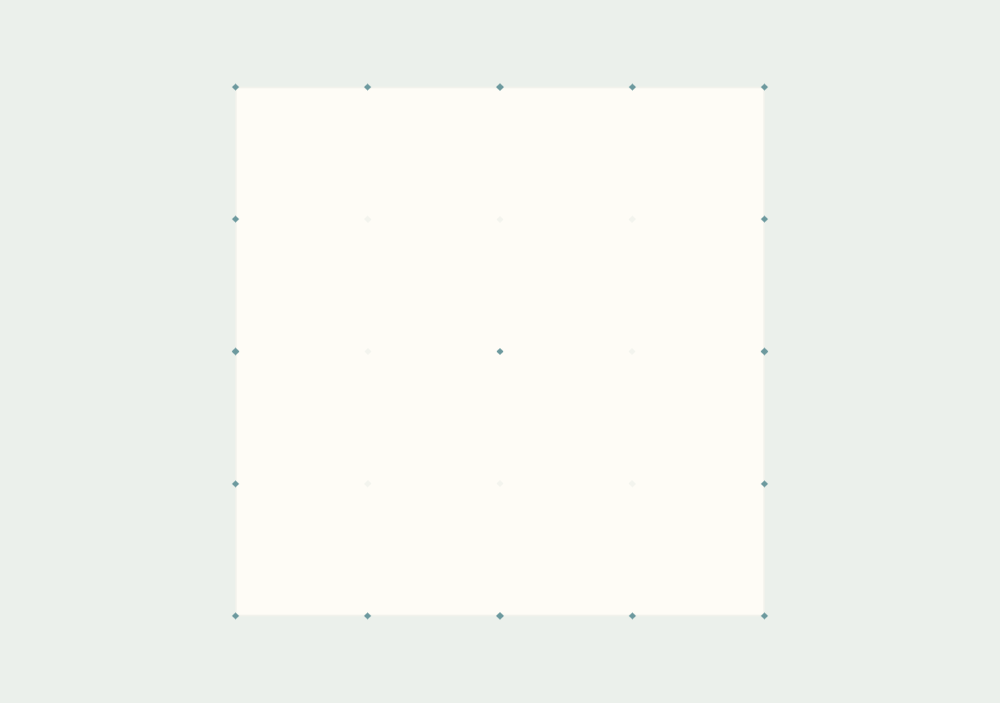

[전체 UI](session-a/full-001.png) · [그 시점의 접기 이력](session-a/recipe-001.json)

## A-002 · base-diagonal-selected

대각선의 두 꼭짓점을 선택하고 왼쪽 위 면을 오른쪽 아래로 접을 준비.

조작: 클릭(301.5, 788.5) → 클릭(978.5, 111.5) → 클릭(440.0, 270.0). 좌표는 작업대 1280×900 기준.

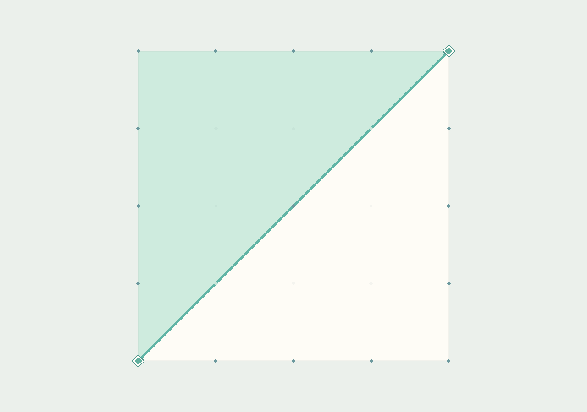

[전체 UI](session-a/full-002.png) · [그 시점의 접기 이력](session-a/recipe-002.json)

## A-003 · base-diagonal-fold

C: 대각선 접기 완료.

조작: C. 좌표는 작업대 1280×900 기준.

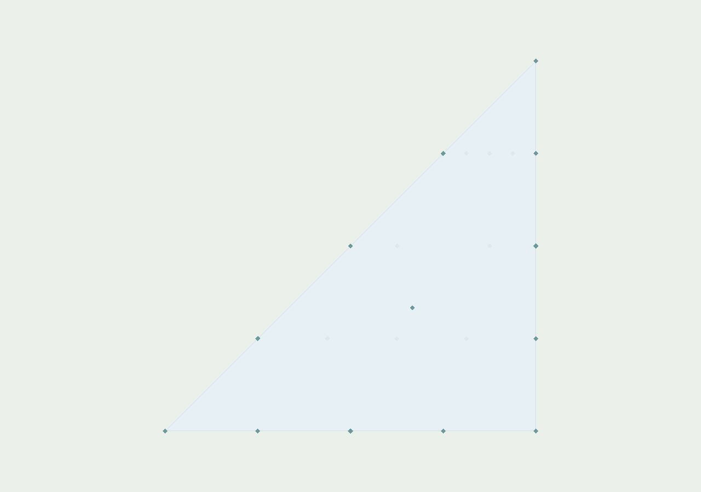

[전체 UI](session-a/full-003.png) · [그 시점의 접기 이력](session-a/recipe-003.json)

## A-004 · base-half-selected

삼각형 중앙에서 직각 꼭짓점까지 선을 긋고 왼쪽 아래 부분 선택.

조작: 클릭(640.0, 450.0) → 클릭(978.5, 788.5) → 클릭(660.0, 710.0). 좌표는 작업대 1280×900 기준.

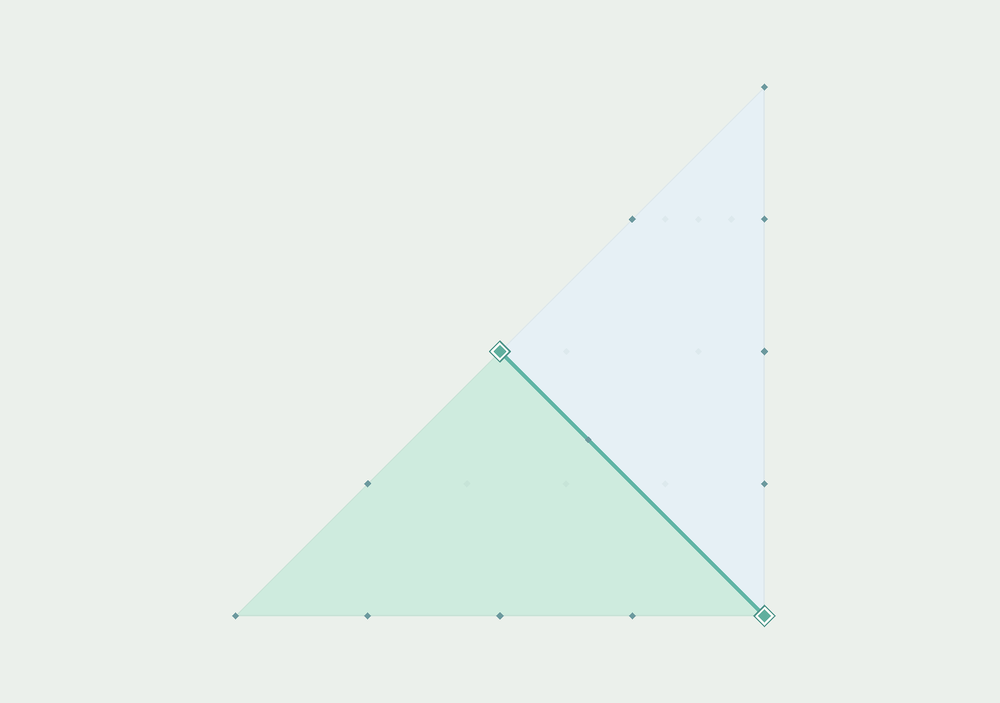

[전체 UI](session-a/full-004.png) · [그 시점의 접기 이력](session-a/recipe-004.json)

## A-005 · base-half-fold

C: 삼각형을 반으로 접기.

조작: C. 좌표는 작업대 1280×900 기준.

[전체 UI](session-a/full-005.png) · [그 시점의 접기 이력](session-a/recipe-005.json)

## A-006 · pocket-edge-selected

pocket-edge-selected

조작: 클릭(978.5, 365.0). 좌표는 작업대 1280×900 기준.

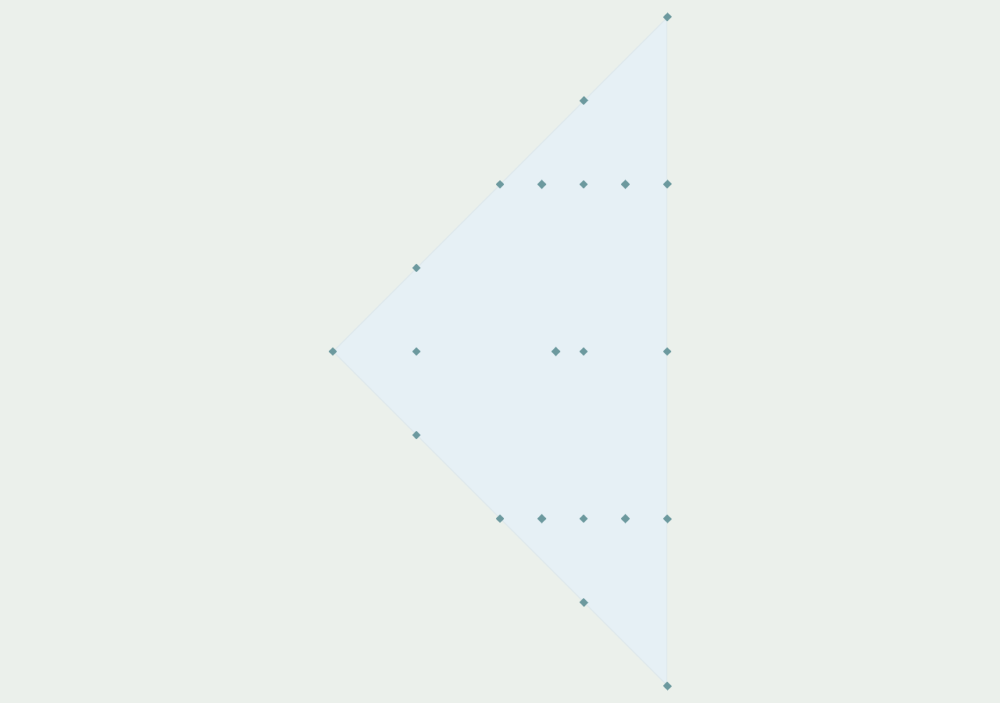

[전체 UI](session-a/full-006.png) · [그 시점의 접기 이력](session-a/recipe-006.json)

## A-007 · pocket-release

pocket-release

조작: 마우스 놓기/대기/상태 관찰. 좌표는 작업대 1280×900 기준.

[전체 UI](session-a/full-007.png) · [그 시점의 접기 이력](session-a/recipe-007.json)

## A-008 · pocket-edge-selected

주머니 변을 클릭해 벌리기/눌러 펴기 대상 선택.

조작: 클릭(854.1, 350.0). 좌표는 작업대 1280×900 기준.

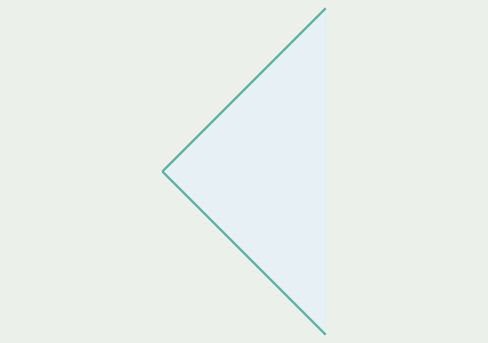

[전체 UI](session-a/full-008.png) · [그 시점의 접기 이력](session-a/recipe-008.json)

## A-009 · pocket-face-selected

선택된 주머니 확인.

조작: 마우스 놓기/대기/상태 관찰. 좌표는 작업대 1280×900 기준.

[전체 UI](session-a/full-009.png) · [그 시점의 접기 이력](session-a/recipe-009.json)

## A-010 · pocket-fold

C: 앞 주머니 눌러 펴기.

조작: C. 좌표는 작업대 1280×900 기준.

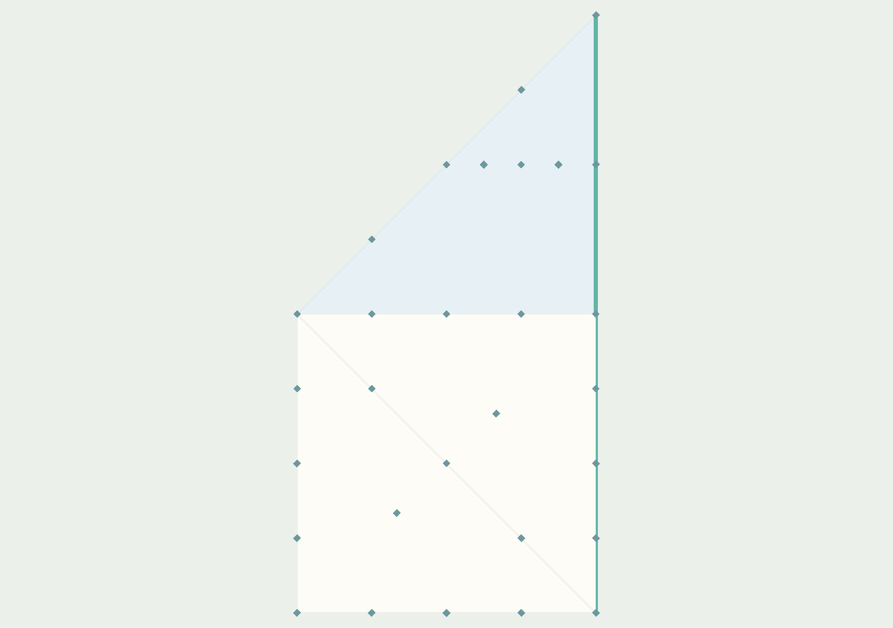

[전체 UI](session-a/full-010.png) · [그 시점의 접기 이력](session-a/recipe-010.json)

## A-011 · back-view

Ctrl+키패드7: 반대쪽 보기.

조작: LeftCtrl → Numpad7. 좌표는 작업대 1280×900 기준.

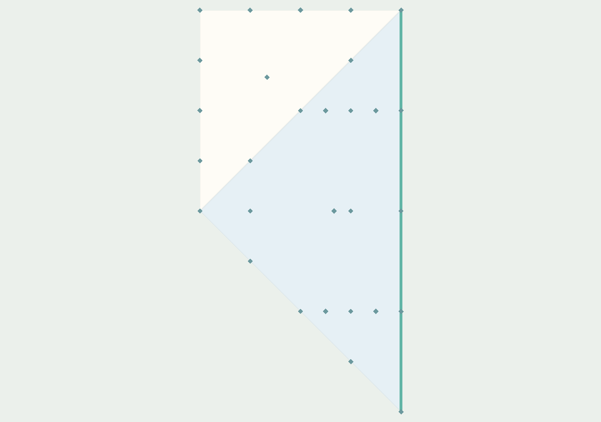

[전체 UI](session-a/full-011.png) · [그 시점의 접기 이력](session-a/recipe-011.json)

## A-012 · back-pocket-selected

back-pocket-selected

조작: 클릭(425.9, 350.0). 좌표는 작업대 1280×900 기준.

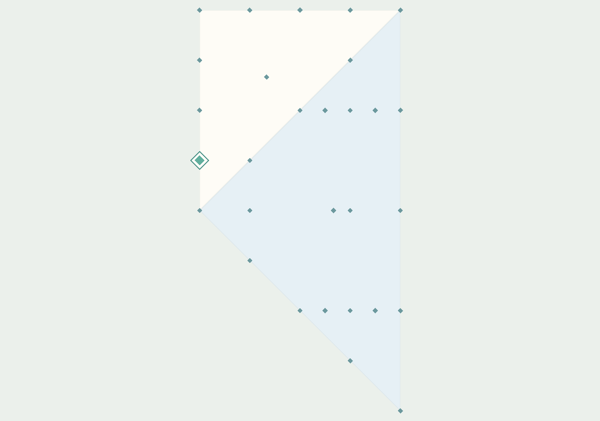

[전체 UI](session-a/full-012.png) · [그 시점의 접기 이력](session-a/recipe-012.json)

## A-013 · back-pocket-edge

반대 주머니의 변 선택.

조작: Escape → 클릭(854.1, 550.0). 좌표는 작업대 1280×900 기준.

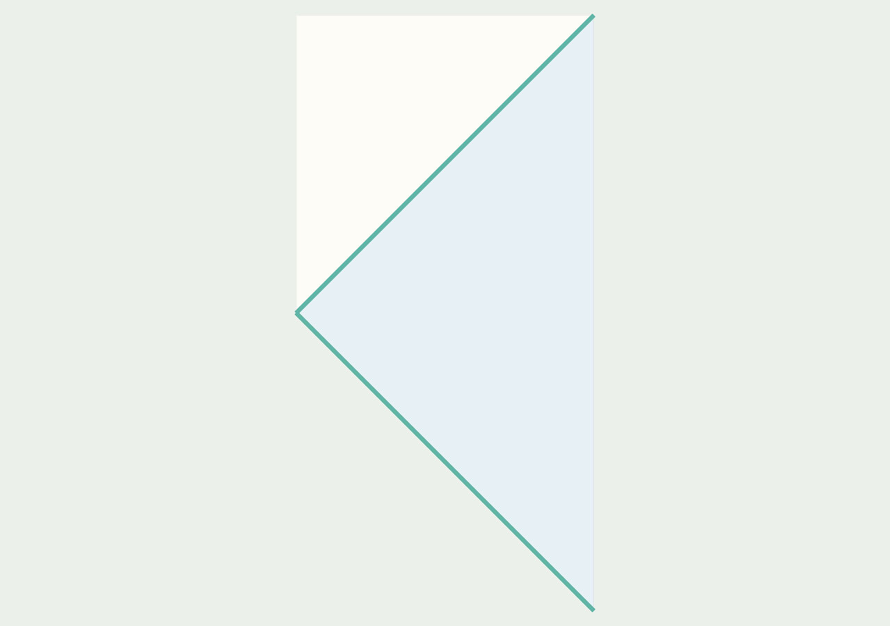

[전체 UI](session-a/full-013.png) · [그 시점의 접기 이력](session-a/recipe-013.json)

## A-014 · back-pocket-fold

C: 반대 주머니 눌러 펴기.

조작: C. 좌표는 작업대 1280×900 기준.

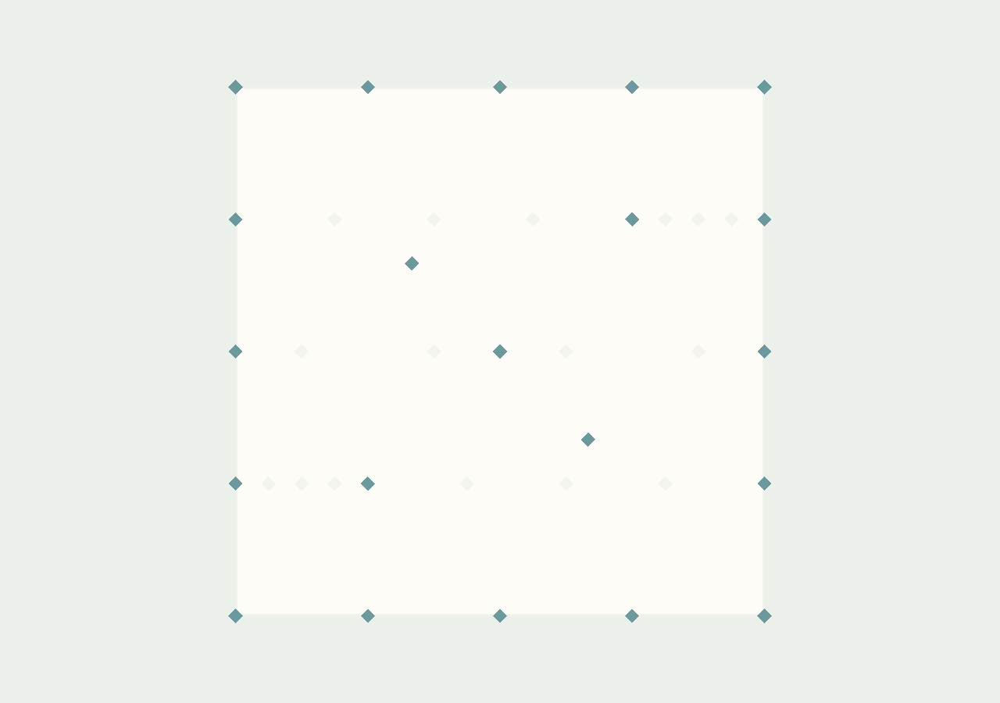

[전체 UI](session-a/full-014.png) · [그 시점의 접기 이력](session-a/recipe-014.json)

## A-015 · orient-square

orient-square

조작: Numpad6 → Numpad6 → Numpad6. 좌표는 작업대 1280×900 기준.

[전체 UI](session-a/full-015.png) · [그 시점의 접기 이력](session-a/recipe-015.json)

## A-016 · petal-points

시도 오류: 화면 밖의 실제 끝점 대신 면 위의 점을 골랐다. 통과로 집계하지 않음.

조작: 클릭(640.0, 878.2) → 클릭(640.0, 450.0) → F → 클릭(211.8, 450.0) → 클릭(1068.2, 450.0). 좌표는 작업대 1280×900 기준.

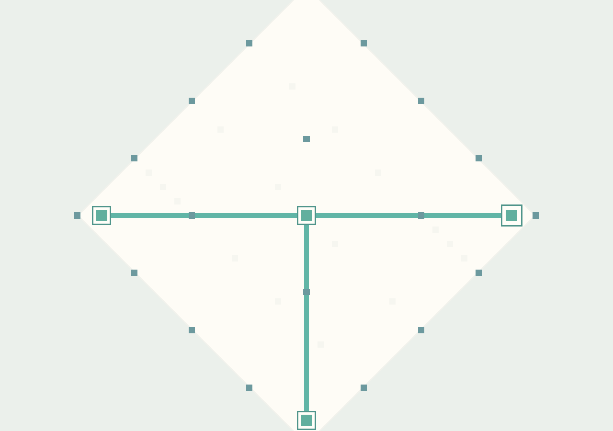

[전체 UI](session-a/full-016.png) · [그 시점의 접기 이력](session-a/recipe-016.json)

## A-017 · fit-square

fit-square

조작: Escape → 휠 -120.0. 좌표는 작업대 1280×900 기준.

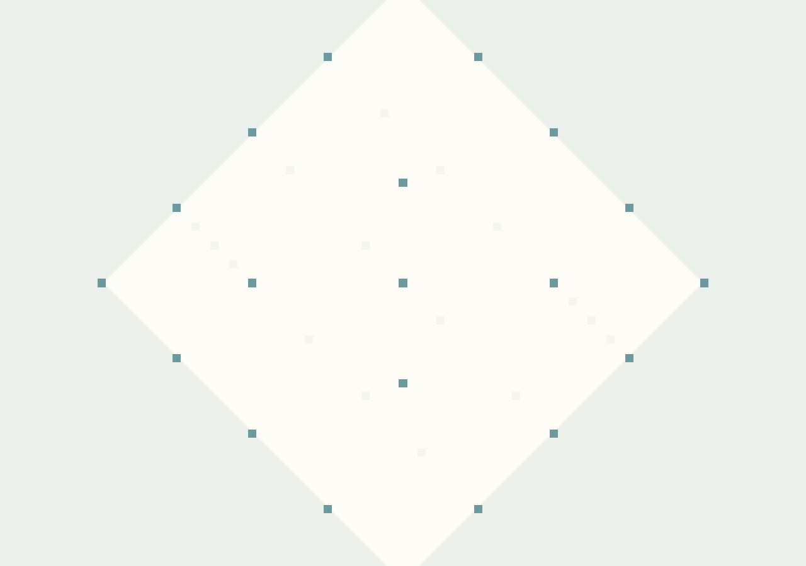

[전체 UI](session-a/full-017.png) · [그 시점의 접기 이력](session-a/recipe-017.json)

## A-018 · zoom-out

휠 아래: 종이의 네 끝점이 화면 안에 보이도록 축소.

조작: 휠 -120.0. 좌표는 작업대 1280×900 기준.

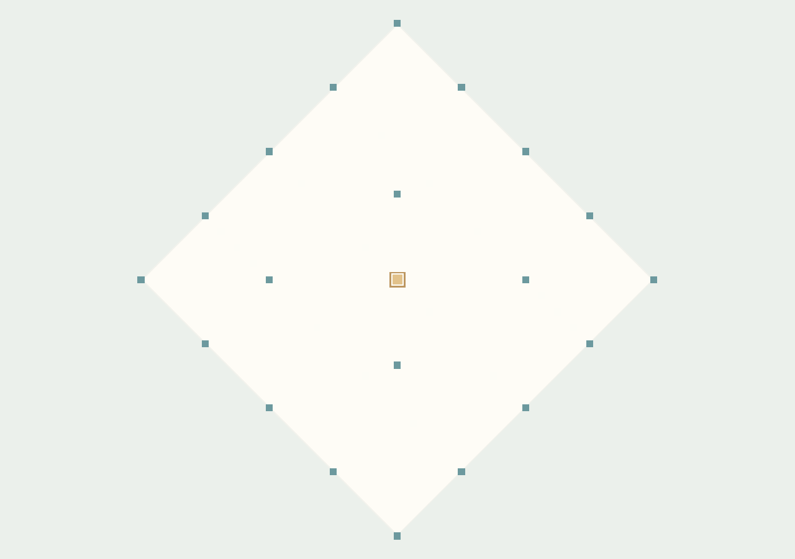

[전체 UI](session-a/full-018.png) · [그 시점의 접기 이력](session-a/recipe-018.json)

## A-019 · front-petal-points

시도 오류: 닫힌 끝 쪽 선택. 꽃잎이 생성되지 않음.

조작: 클릭(639.8, 863.0) → 클릭(639.8, 450.3) → F → 클릭(227.1, 450.3) → 클릭(1052.5, 450.3). 좌표는 작업대 1280×900 기준.

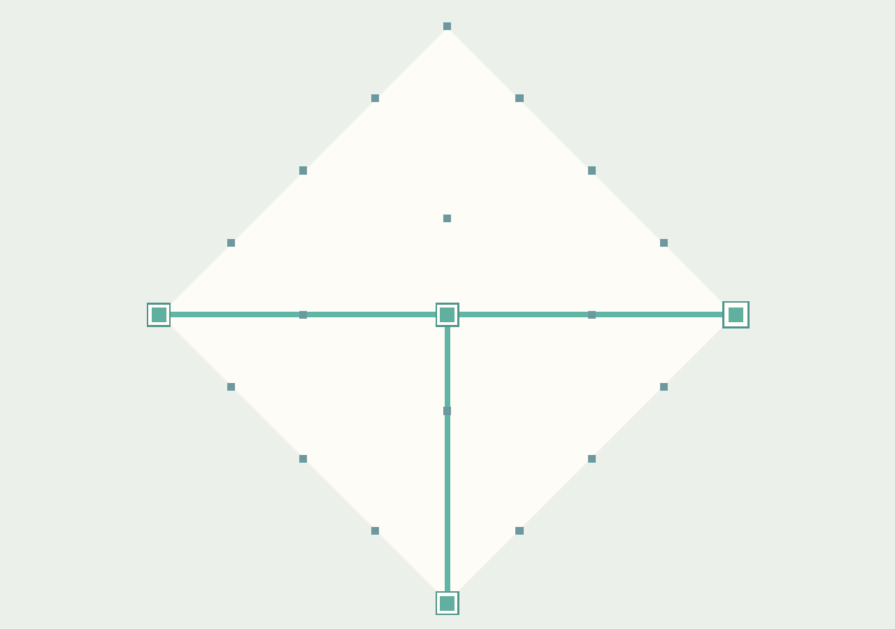

[전체 UI](session-a/full-019.png) · [그 시점의 접기 이력](session-a/recipe-019.json)

## A-020 · opposite-petal-points

시도 오류: 꽃잎의 기준점으로 반대 꼭짓점 대신 면 중앙을 지정.

조작: Escape → 클릭(639.8, 37.6) → 클릭(639.8, 450.3) → F → 클릭(227.1, 450.3) → 클릭(1052.5, 450.3). 좌표는 작업대 1280×900 기준.

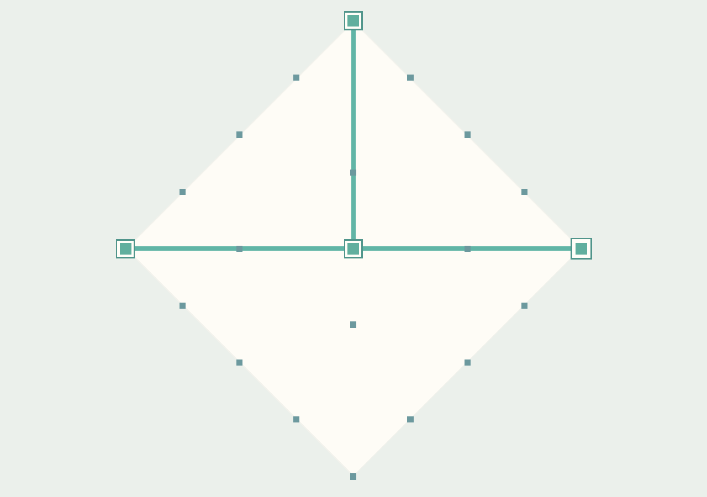

[전체 UI](session-a/full-020.png) · [그 시점의 접기 이력](session-a/recipe-020.json)

## A-021 · side-petal-points

닫힌 쪽 선택 시도: 주변 겹 접촉으로 거부.

조작: Escape → 클릭(227.1, 450.3) → 클릭(639.8, 450.3) → F → 클릭(639.8, 37.6) → 클릭(639.8, 863.0). 좌표는 작업대 1280×900 기준.

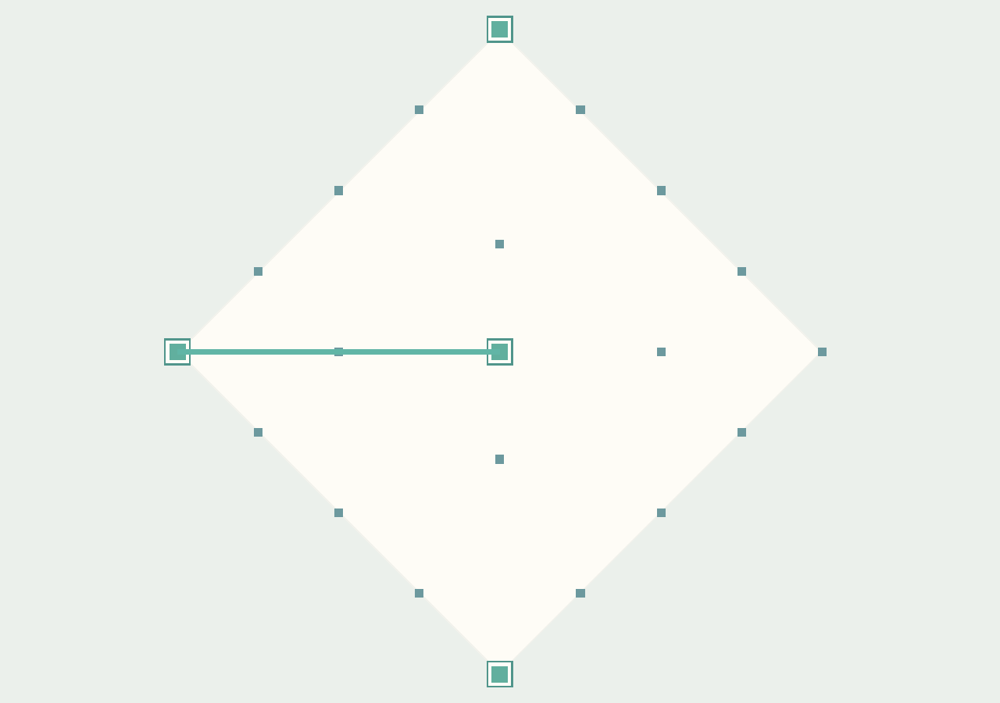

[전체 UI](session-a/full-021.png) · [그 시점의 접기 이력](session-a/recipe-021.json)

## A-022 · petal-route

petal-route

조작: 마우스 놓기/대기/상태 관찰. 좌표는 작업대 1280×900 기준.

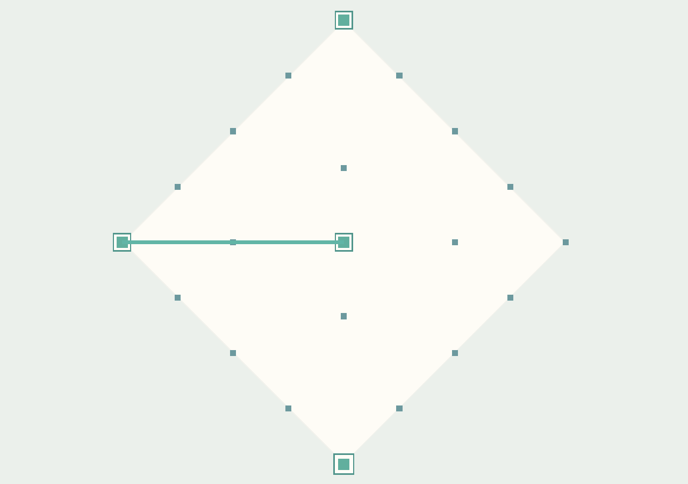

[전체 UI](session-a/full-022.png) · [그 시점의 접기 이력](session-a/recipe-022.json)

## A-023 · right-petal-points

기준점 오선택: 면 중앙을 고른 4점 조작.

조작: Escape → 클릭(1052.5, 450.3) → 클릭(639.8, 450.3) → F → 클릭(639.8, 37.6) → 클릭(639.8, 863.0). 좌표는 작업대 1280×900 기준.

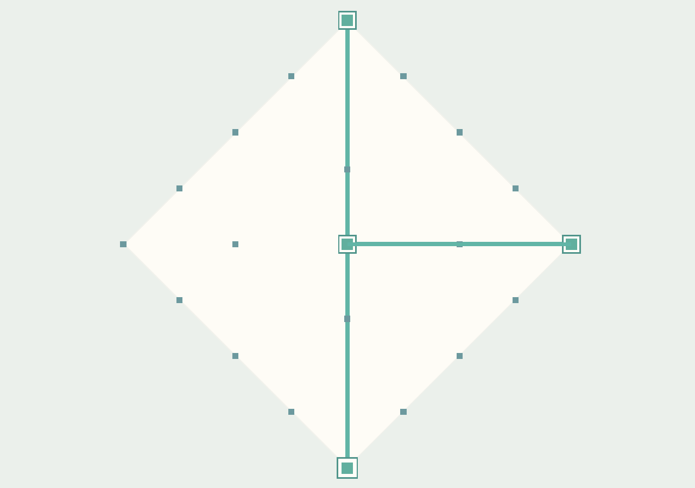

[전체 UI](session-a/full-023.png) · [그 시점의 접기 이력](session-a/recipe-023.json)

## A-024 · front-petal-face

front-petal-face

조작: 클릭(850.0, 520.0). 좌표는 작업대 1280×900 기준.

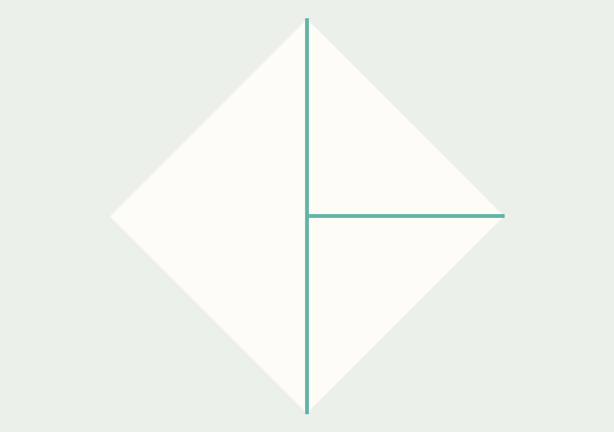

[전체 UI](session-a/full-024.png) · [그 시점의 접기 이력](session-a/recipe-024.json)

## A-025 · front-petal-fold

접기 계산은 끝났으나 도안의 꽃잎 모양과 불일치. 27번에서 되돌림.

조작: C. 좌표는 작업대 1280×900 기준.

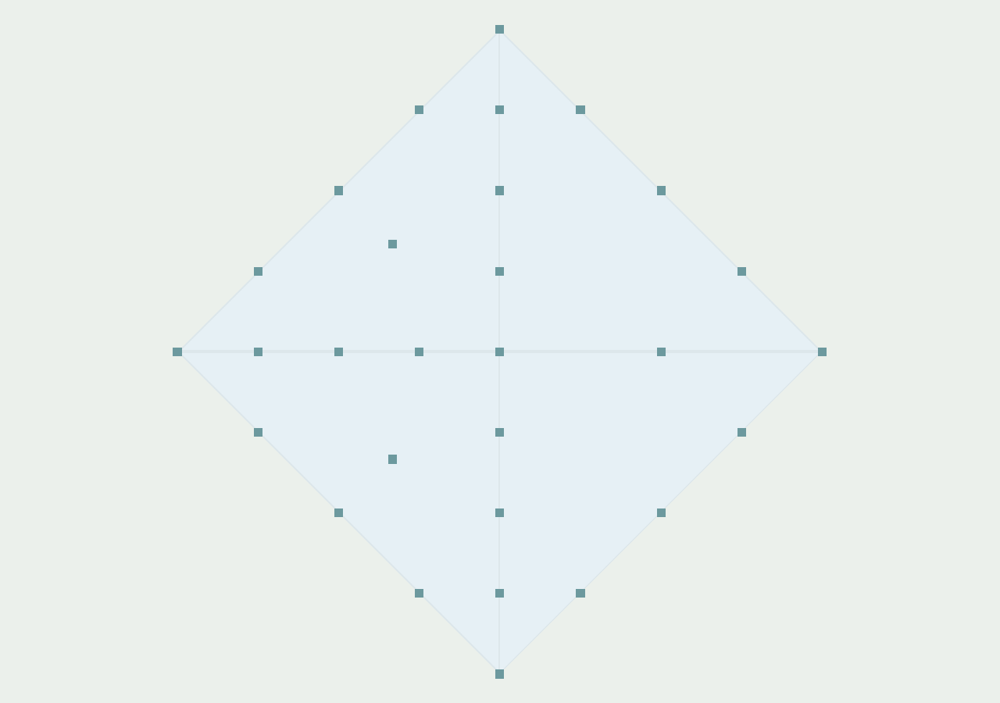

[전체 UI](session-a/full-025.png) · [그 시점의 접기 이력](session-a/recipe-025.json)

## A-026 · back-for-partial-petal

back-for-partial-petal

조작: B. 좌표는 작업대 1280×900 기준.

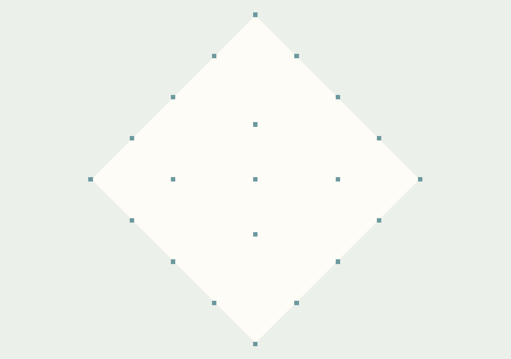

[전체 UI](session-a/full-026.png) · [그 시점의 접기 이력](session-a/recipe-026.json)

## A-027 · correct-petal-axis

Z로 잘못된 결과를 되돌리고, 열린 끝→반대 꼭짓점→양옆 꼭짓점을 다시 선택.

조작: Z → B → 클릭(1052.5, 450.3) → 클릭(227.1, 450.3) → F → 클릭(639.8, 37.6) → 클릭(639.8, 863.0). 좌표는 작업대 1280×900 기준.

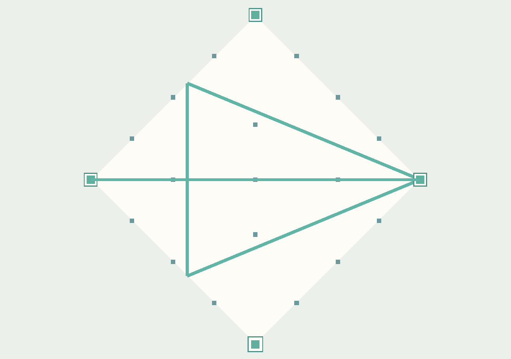

[전체 UI](session-a/full-027.png) · [그 시점의 접기 이력](session-a/recipe-027.json)

## A-028 · true-petal-face

진짜 꽃잎 접기의 이동 면 확인.

조작: 클릭(850.0, 520.0). 좌표는 작업대 1280×900 기준.

[전체 UI](session-a/full-028.png) · [그 시점의 접기 이력](session-a/recipe-028.json)

## A-029 · true-petal-fold

C: 도안 4~7의 앞면 꽃잎 완료. 길어진 끝 모양 확인.

조작: C. 좌표는 작업대 1280×900 기준.

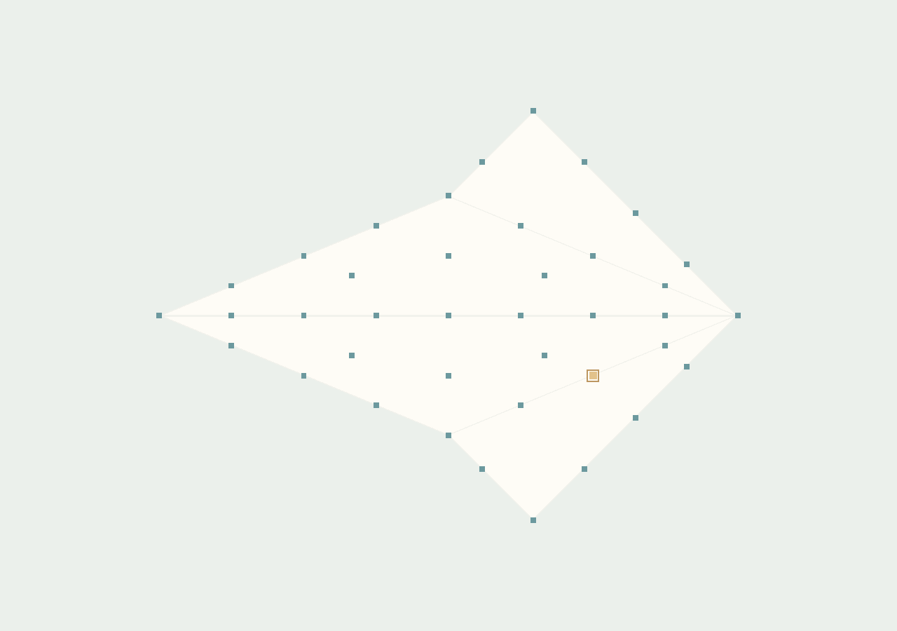

[전체 UI](session-a/full-029.png) · [그 시점의 접기 이력](session-a/recipe-029.json)

## A-030 · diagram-8-back

B: 뒷면 보기.

조작: B. 좌표는 작업대 1280×900 기준.

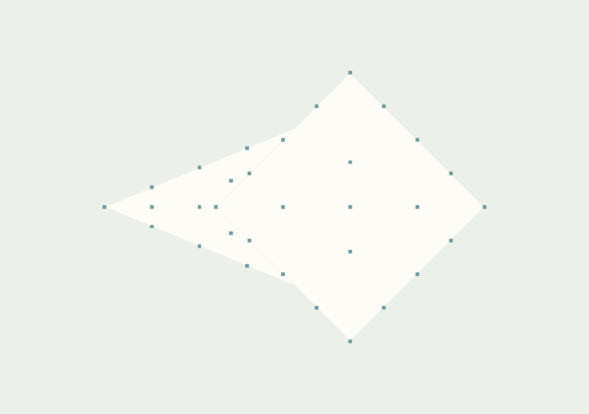

[전체 UI](session-a/full-030.png) · [그 시점의 접기 이력](session-a/recipe-030.json)

## A-031 · orient-dragon

키패드4 여섯 번: 도안처럼 긴 끝을 위로 향하게 회전.

조작: Numpad4 → Numpad4 → Numpad4 → Numpad4 → Numpad4 → Numpad4. 좌표는 작업대 1280×900 기준.

[전체 UI](session-a/full-031.png) · [그 시점의 접기 이력](session-a/recipe-031.json)

## A-032 · diagram-8-edge-match

도안 해석 오류: 바깥 변을 중앙선에 맞췄다. 실제 8번 방향은 그 반대.

조작: M → 클릭(494.3, 716.6) → 클릭(640.2, 650.0). 좌표는 작업대 1280×900 기준.

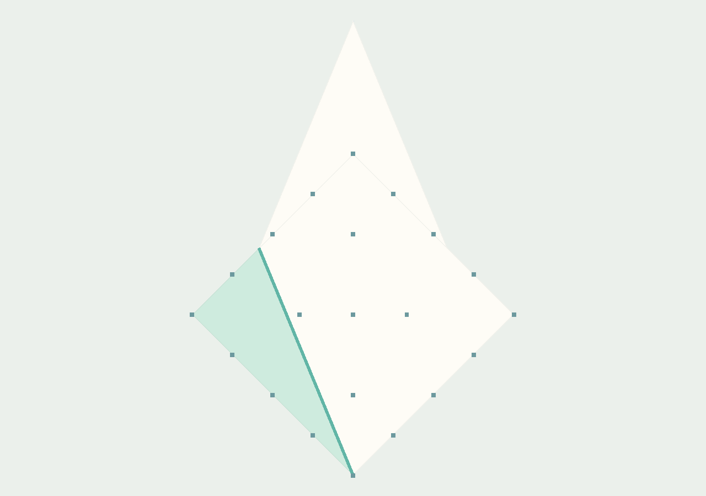

[전체 UI](session-a/full-032.png) · [그 시점의 접기 이력](session-a/recipe-032.json)

## A-033 · diagram-8-fold

잘못 해석한 준비 접기 결과. 완료 단계로 집계하지 않음.

조작: C. 좌표는 작업대 1280×900 기준.

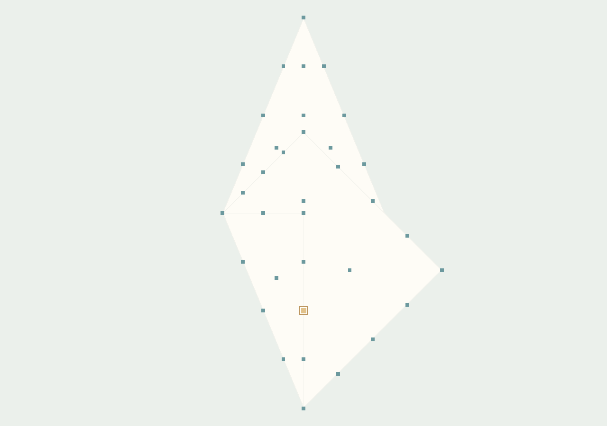

[전체 UI](session-a/full-033.png) · [그 시점의 접기 이력](session-a/recipe-033.json)

## A-034 · diagram-9-reopen

Z: 준비 접기 제거. 다음 도안 판독 후 방향 정정.

조작: Z. 좌표는 작업대 1280×900 기준.

[전체 UI](session-a/full-034.png) · [그 시점의 접기 이력](session-a/recipe-034.json)

## A-035 · diagram-10-half-petal-points

잘못된 가정의 반쪽 꽃잎 시도. 네 점 선택됨.

조작: 클릭(640.2, 862.5) → 클릭(640.2, 278.9) → F → 클릭(348.4, 570.7) → 클릭(640.2, 570.7). 좌표는 작업대 1280×900 기준.

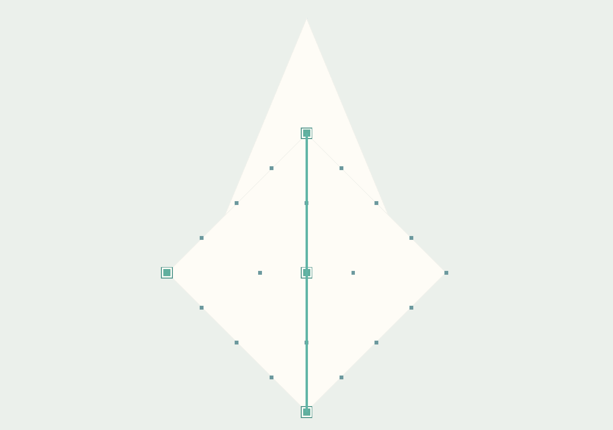

[전체 UI](session-a/full-035.png) · [그 시점의 접기 이력](session-a/recipe-035.json)

## A-036 · diagram-10-route

해당 점 조합은 주변 겹에 막힘. 아직 올바른 도안 단계 재현이 아님.

조작: 마우스 놓기/대기/상태 관찰. 좌표는 작업대 1280×900 기준.

[전체 UI](session-a/full-036.png) · [그 시점의 접기 이력](session-a/recipe-036.json)

## A-037 · diagram-8-correct-match

도안 8번의 올바른 방향: 중앙 변→왼쪽 위 바깥 변. 왼쪽 클릭이 오른쪽 면으로 잡혀 Plan이 거부되는 공유 변 선택 오류 재현.

조작: Escape → M → 클릭(637.0, 650.0) → 클릭(494.3, 424.8). 좌표는 작업대 1280×900 기준.

[전체 UI](session-a/full-037.png) · [그 시점의 접기 이력](session-a/recipe-037.json)

## A-038 · quit

quit

조작: 마우스 놓기/대기/상태 관찰. 좌표는 작업대 1280×900 기준.

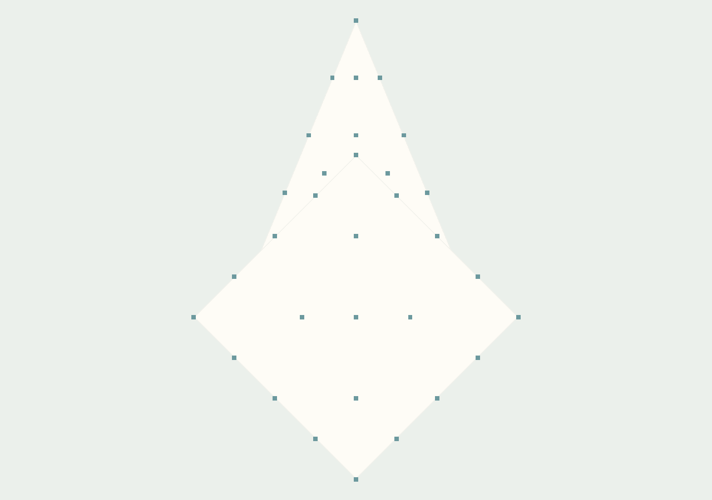

종료 순간 전체 UI 캡처는 생성되지 않음(위 작업대 캡처 참조) · [그 시점의 접기 이력](session-a/recipe-038.json)

## B-001 · reopen

동일한 5회 접기 체크포인트에서 재시작.

조작: Numpad7 → Numpad4 → Numpad4 → Numpad4 → 휠 -120.0. 좌표는 작업대 1280×900 기준.

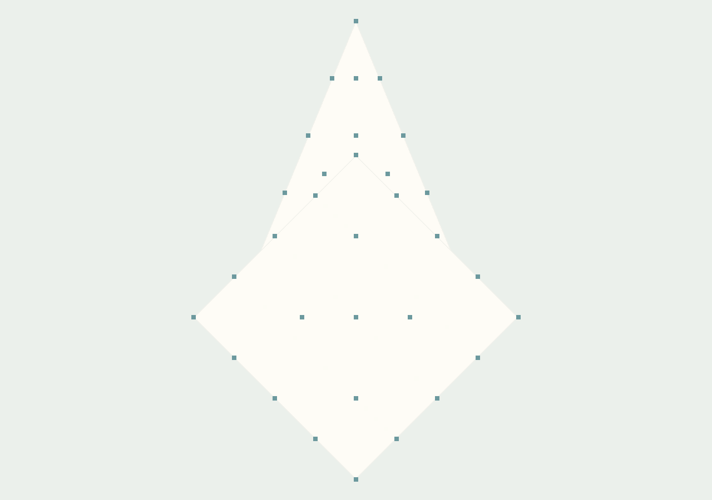

[전체 UI](session-b/full-001.png) · [그 시점의 접기 이력](session-b/recipe-001.json)

## B-002 · shared-source

중앙선 왼쪽을 클릭했지만 source.face=12(오른쪽).

조작: M → 클릭(637.0, 650.0). 좌표는 작업대 1280×900 기준.

[전체 UI](session-b/full-002.png) · [그 시점의 접기 이력](session-b/recipe-002.json)

## B-003 · shared-target

왼쪽 바깥 변은 face=14. 서로 다른 잘못된 source 선택 때문에 정렬 거부.

조작: 클릭(494.3, 424.8). 좌표는 작업대 1280×900 기준.

[전체 UI](session-b/full-003.png) · [그 시점의 접기 이력](session-b/recipe-003.json)

## B-004 · quit

수정 전 검사 종료. 사용자 저장본은 변경하지 않음.

조작: 마우스 놓기/대기/상태 관찰. 좌표는 작업대 1280×900 기준.

종료 순간 전체 UI 캡처는 생성되지 않음(위 작업대 캡처 참조) · [그 시점의 접기 이력](session-b/recipe-004.json)

## C-001 · reopen

같은 체크포인트 재시작.

조작: Numpad7 → Numpad4 → Numpad4 → Numpad4

[전체 UI](session-c/full-001.png) · [접기 이력](session-c/recipe-001.json)

## C-002 · diagram-8-match-selected

공유 변은 클릭한 면을 선택하게 수정됐지만, 이 방향의 전체 반전 요청은 계속 거부됨. 도안의 이동 쪽을 재검토.

조작: M → 클릭(637.0, 650.0) → 클릭(494.3, 424.8)

[전체 UI](session-c/full-002.png) · [접기 이력](session-c/recipe-002.json)

## C-003 · quit

quit

조작: 놓기/관찰

종료 순간 전체 UI 캡처는 생성되지 않음(위 작업대 캡처 참조) · [접기 이력](session-c/recipe-003.json)

## D-001 · reopen

5회 접기 체크포인트 재시작.

조작: Numpad7 → Numpad4 → Numpad4 → Numpad4

[전체 UI](session-d/full-001.png) · [접기 이력](session-d/recipe-001.json)

## D-002 · diagram-8-axis-side

준비 접기 후보: 바깥 변→중앙선. 자동 계산한 접는 선과 이동 면.

조작: M → 클릭(494.3, 424.8) → 클릭(637.0, 650.0)

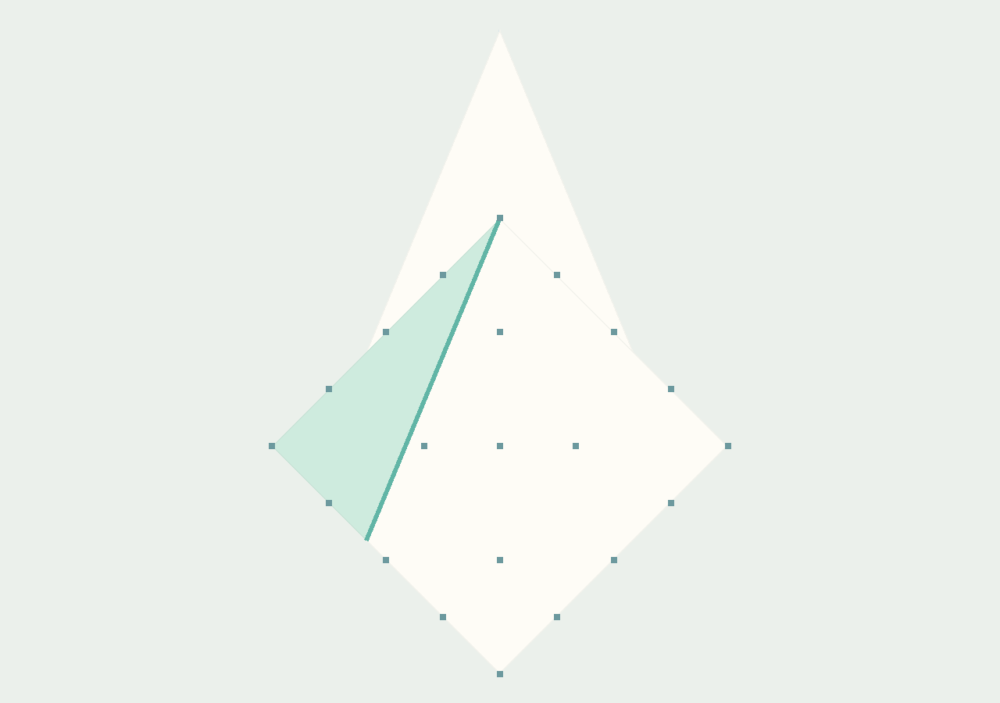

[전체 UI](session-d/full-002.png) · [접기 이력](session-d/recipe-002.json)

## D-003 · diagram-8-fold

준비 접기 결과.

조작: C

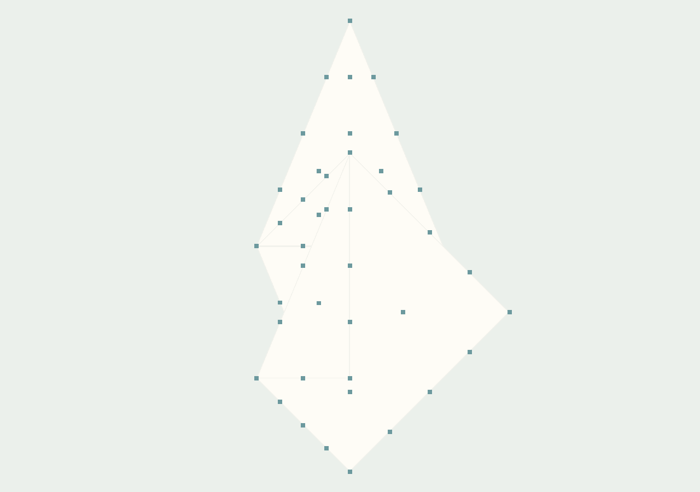

[전체 UI](session-d/full-003.png) · [접기 이력](session-d/recipe-003.json)

## D-004 · diagram-9-pocket-hover

중앙 변에서 주머니 선택을 시도했지만 점 선택으로 처리.

조작: 클릭(640.0, 510.0)

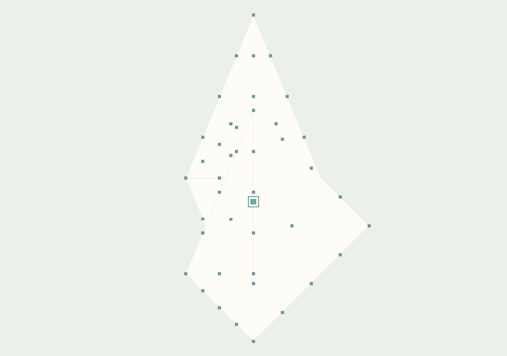

[전체 UI](session-d/full-004.png) · [접기 이력](session-d/recipe-004.json)

## D-005 · diagram-9-squash-edge

기울어진 변도 점 선택으로 처리.

조작: Escape → 클릭(571.0, 445.0)

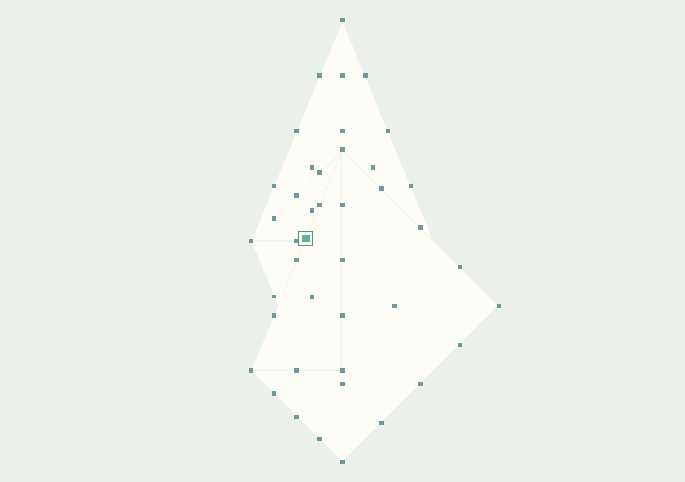

[전체 UI](session-d/full-005.png) · [접기 이력](session-d/recipe-005.json)

## D-006 · diagram-9-open-base

아래쪽 짧은 수평 변을 잡아 주머니 선택 성공.

조작: Escape → 클릭(505.0, 692.0)

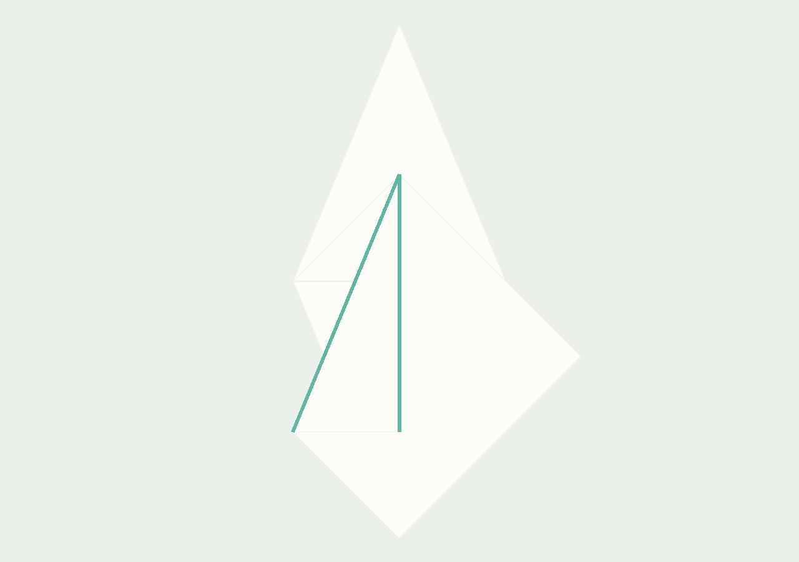

[전체 UI](session-d/full-006.png) · [접기 이력](session-d/recipe-006.json)

## D-007 · diagram-9-squash

주머니는 펼쳐졌지만 도안 10과 다른 방향. 되돌림.

조작: C

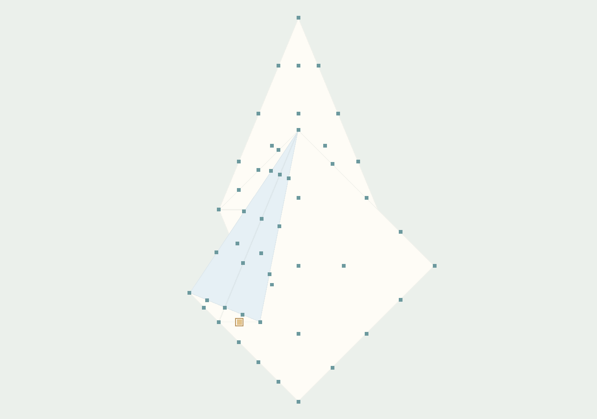

[전체 UI](session-d/full-007.png) · [접기 이력](session-d/recipe-007.json)

## D-008 · rabbit-ear-points

Z 두 번으로 5회 상태 복귀. 반쪽 삼각형 4점 선택 시도: 계획 생성 안 됨.

조작: Z → Z → 클릭(348.4, 570.7) → 클릭(640.2, 570.7) → F → 클릭(640.2, 278.9) → 클릭(640.2, 862.5)

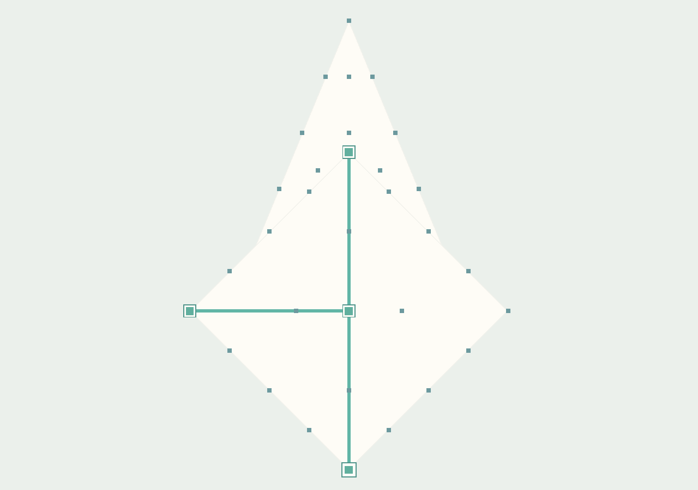

[전체 UI](session-d/full-008.png) · [접기 이력](session-d/recipe-008.json)

## D-009 · rabbit-ear-incenter

삼각형 내심을 기준으로 지정한 시도: 계획 생성 안 됨.

조작: Escape → 클릭(348.4, 570.7) → 클릭(519.4, 570.7) → F → 클릭(640.2, 278.9) → 클릭(640.2, 862.5)

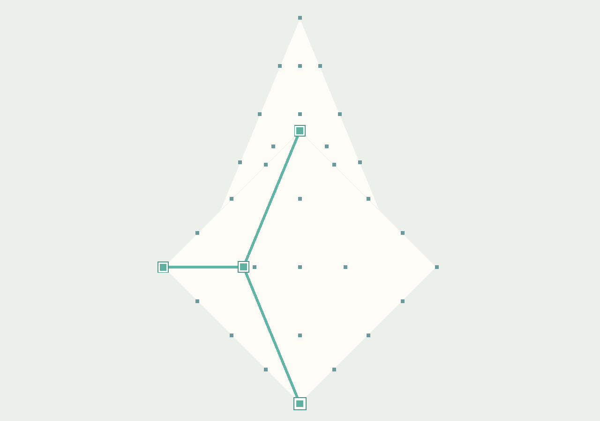

[전체 UI](session-d/full-009.png) · [접기 이력](session-d/recipe-009.json)

## D-010 · diagram-9-centre-axis

도안 9의 중앙 축을 두 점으로 정하고 왼쪽 면 선택.

조작: Escape → 클릭(640.2, 278.9) → 클릭(640.2, 862.5) → 클릭(500.0, 570.0)

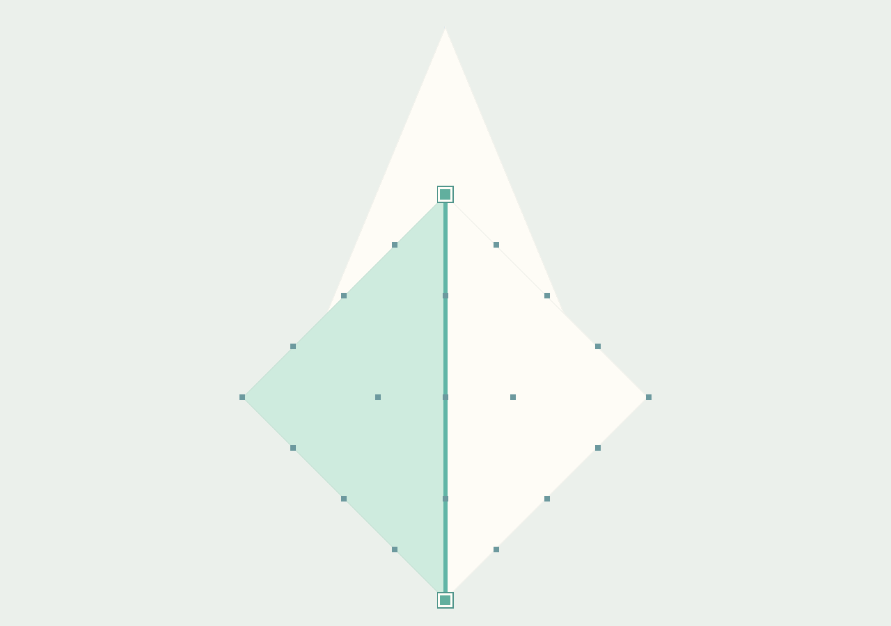

[전체 UI](session-d/full-010.png) · [접기 이력](session-d/recipe-010.json)

## D-011 · diagram-9-centre-fold

C: 왼쪽 윗겹을 오른쪽으로 접기.

조작: C

[전체 UI](session-d/full-011.png) · [접기 이력](session-d/recipe-011.json)

## D-012 · diagram-9-flatten-pocket

오른쪽 아래의 겹친 변을 선택해 주머니 펼치기 준비.

조작: 클릭(820.0, 683.0)

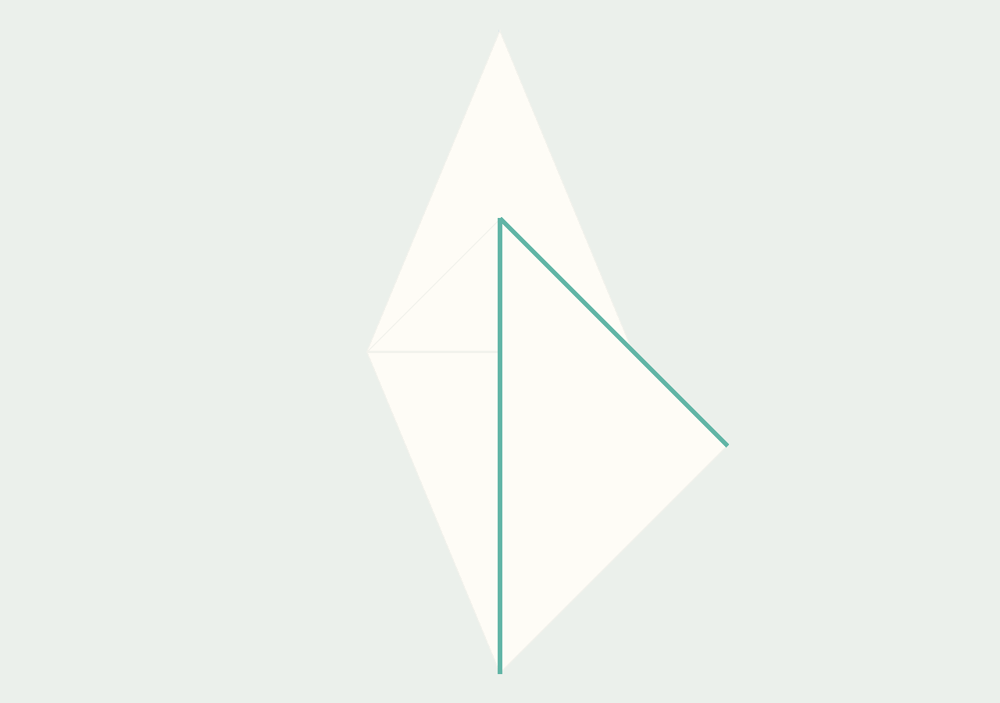

[전체 UI](session-d/full-012.png) · [접기 이력](session-d/recipe-012.json)

## D-013 · diagram-9-pocket-result

C: 주머니를 눌러 펴기. 도안 10의 작은 삼각 주머니가 있는 상태까지 도달.

조작: C

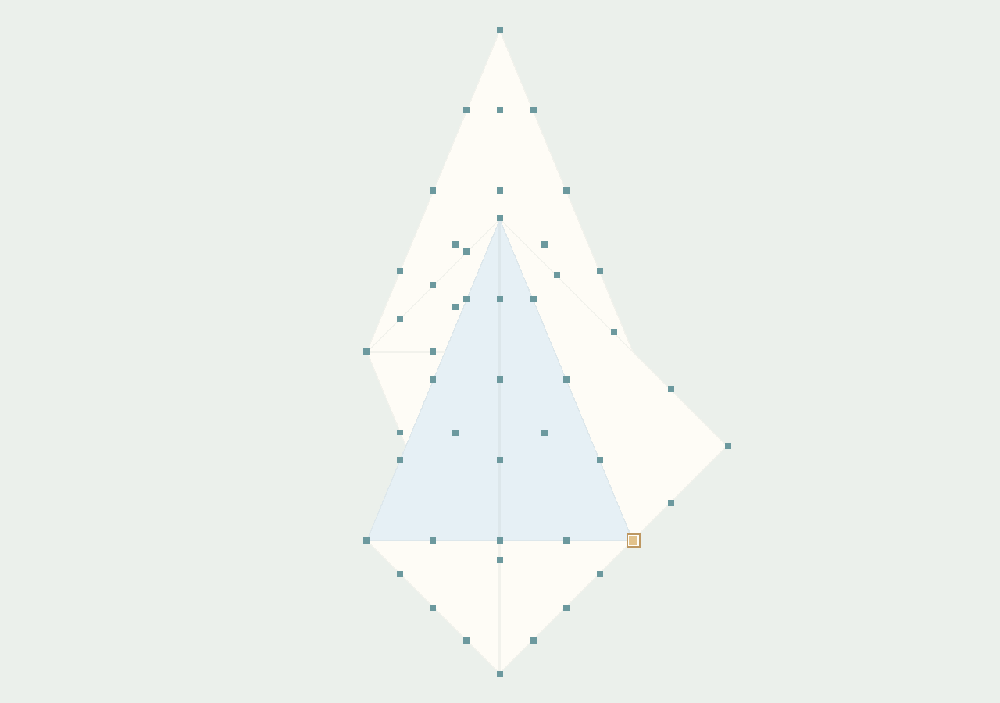

[전체 UI](session-d/full-013.png) · [접기 이력](session-d/recipe-013.json)

## D-014 · diagram-10-small-petal-points

아래 받침 종이의 끝을 1번으로 선택한 네 점 시도.

조작: 클릭(640.2, 862.5) → 클릭(640.2, 278.9) → F → 클릭(468.4, 692.0) → 클릭(811.3, 692.0)

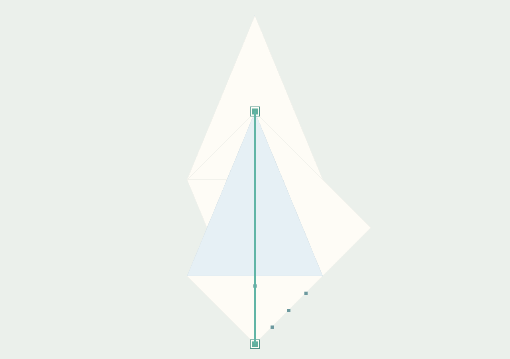

[전체 UI](session-d/full-014.png) · [접기 이력](session-d/recipe-014.json)

## D-015 · diagram-10-route

경로 생성 실패. 진단 결과 선택한 재료 영역이 시작 면을 포함하지 않음.

조작: 놓기/관찰

[전체 UI](session-d/full-015.png) · [접기 이력](session-d/recipe-015.json)

## D-016 · quit

완성 상태가 아닌 7회 체크포인트로 보존하고 종료.

조작: 놓기/관찰

종료 순간 전체 UI 캡처는 생성되지 않음(위 작업대 캡처 참조) · [접기 이력](session-d/recipe-016.json)

## E-001 · reopen

7회 체크포인트 재시작.

조작: Numpad7 → Numpad4 → Numpad4 → Numpad4

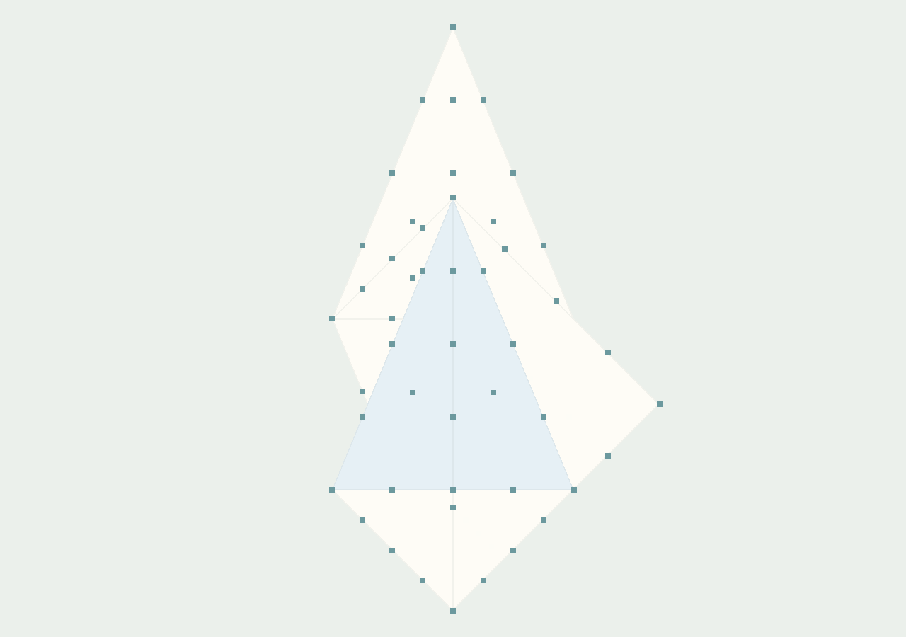

[전체 UI](session-e/full-001.png) · [접기 이력](session-e/recipe-001.json)

## E-002 · small-petal-free-edge

작은 주머니의 자유 가장자리 중앙을 1번으로 변경. 꽃잎이 아니라 변 맞추기로 인식됨.

조작: 클릭(640.0, 692.0) → 클릭(640.0, 279.0) → F → 클릭(468.0, 692.0) → 클릭(811.0, 692.0)

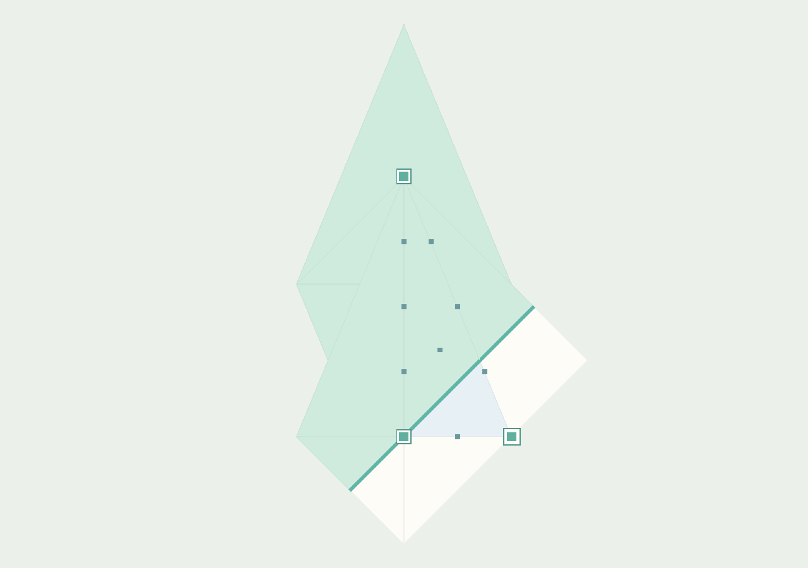

[전체 UI](session-e/full-002.png) · [접기 이력](session-e/recipe-002.json)

## E-003 · quit

이 선택 상태도 별도로 저장하고 종료.

조작: 놓기/관찰

종료 순간 전체 UI 캡처는 생성되지 않음(위 작업대 캡처 참조) · [접기 이력](session-e/recipe-003.json)

## F-001 · reopen

동일한 7회 상태에서 경계 분할 후보 수정으로 재시험.

조작: Numpad7 → Numpad4 → Numpad4 → Numpad4

[전체 UI](session-f/full-001.png) · [접기 이력](session-f/recipe-001.json)

## F-002 · small-petal-intersections

삼각형 양옆 경계의 교차점 기준으로 선택.

조작: 클릭(640.0, 692.0) → 클릭(640.0, 279.0) → F → 클릭(519.4, 570.7) → 클릭(760.6, 570.7)

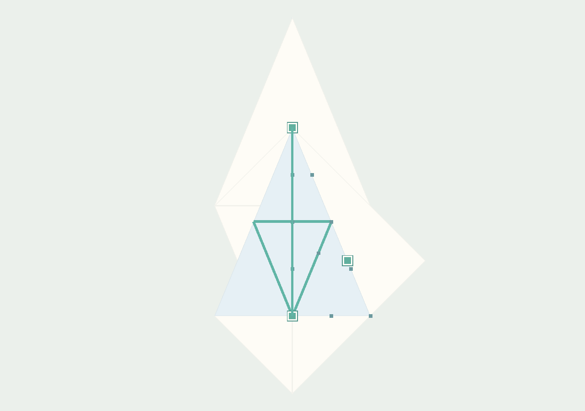

[전체 UI](session-f/full-002.png) · [접기 이력](session-f/recipe-002.json)

## F-003 · small-petal-route

여전히 접힘 경로가 생성되지 않음. 후보 수정 실패.

조작: 놓기/관찰

[전체 UI](session-f/full-003.png) · [접기 이력](session-f/recipe-003.json)

## F-004 · quit

실패 상태 보존 후 종료. 경계 분할 후보는 제거 예정.

조작: 놓기/관찰

종료 순간 전체 UI 캡처는 생성되지 않음(위 작업대 캡처 참조) · [접기 이력](session-f/recipe-004.json)

## G-001 · reopen

양옆 받침 면을 먼저 만드는 별도 조작 가설. 도안 완료로 집계하지 않음.

[레시피](session-g/recipe-001.json)

## G-002 · small-kite-left-select

양옆 받침 면을 먼저 만드는 별도 조작 가설. 도안 완료로 집계하지 않음.

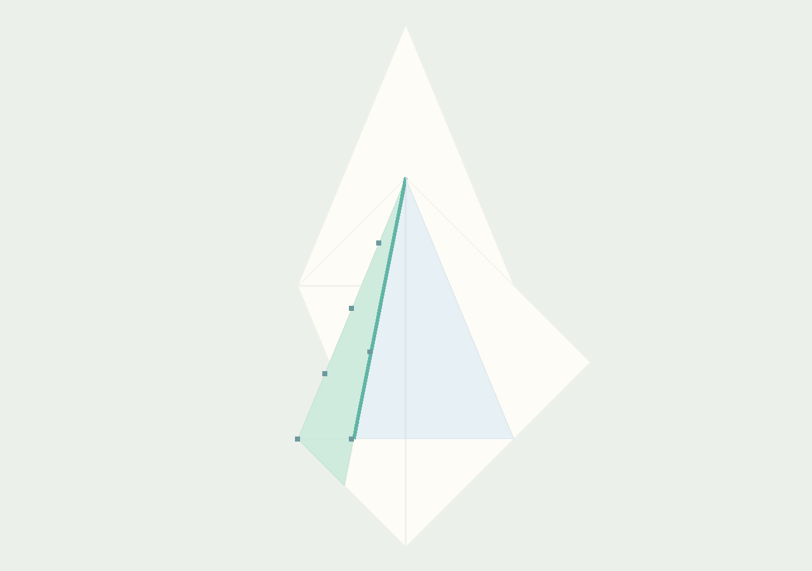

[레시피](session-g/recipe-002.json)

## G-003 · small-kite-left-fold

양옆 받침 면을 먼저 만드는 별도 조작 가설. 도안 완료로 집계하지 않음.

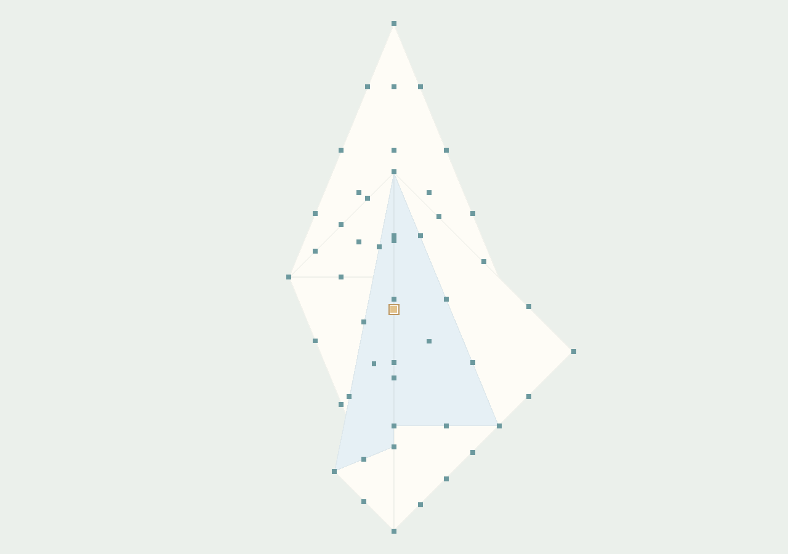

[레시피](session-g/recipe-003.json)

## G-004 · small-kite-right-select

양옆 받침 면을 먼저 만드는 별도 조작 가설. 도안 완료로 집계하지 않음.

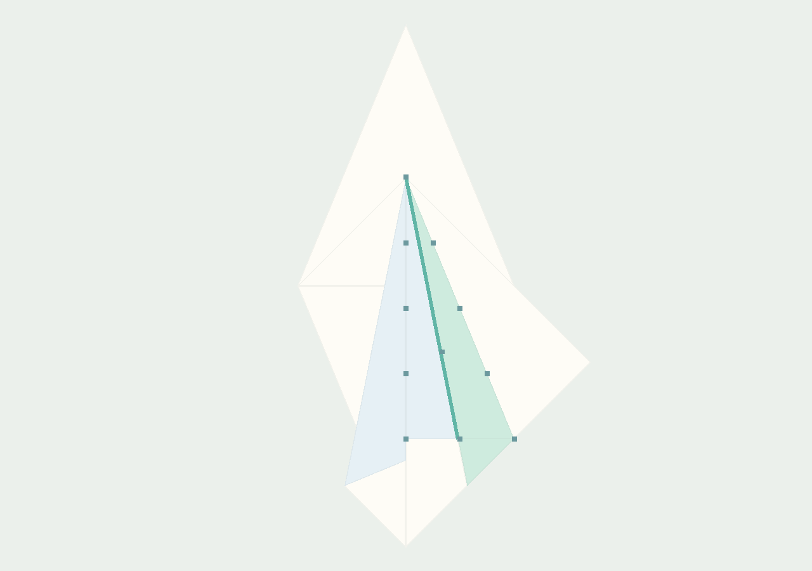

[레시피](session-g/recipe-004.json)

## G-005 · small-kite-right-fold

양옆 받침 면을 먼저 만드는 별도 조작 가설. 도안 완료로 집계하지 않음.

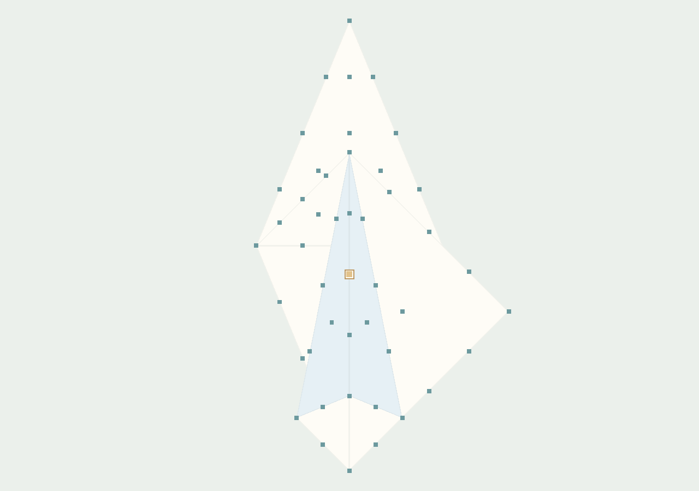

[레시피](session-g/recipe-005.json)

## G-006 · quit

양옆 받침 면을 먼저 만드는 별도 조작 가설. 도안 완료로 집계하지 않음.

[레시피](session-g/recipe-006.json)
