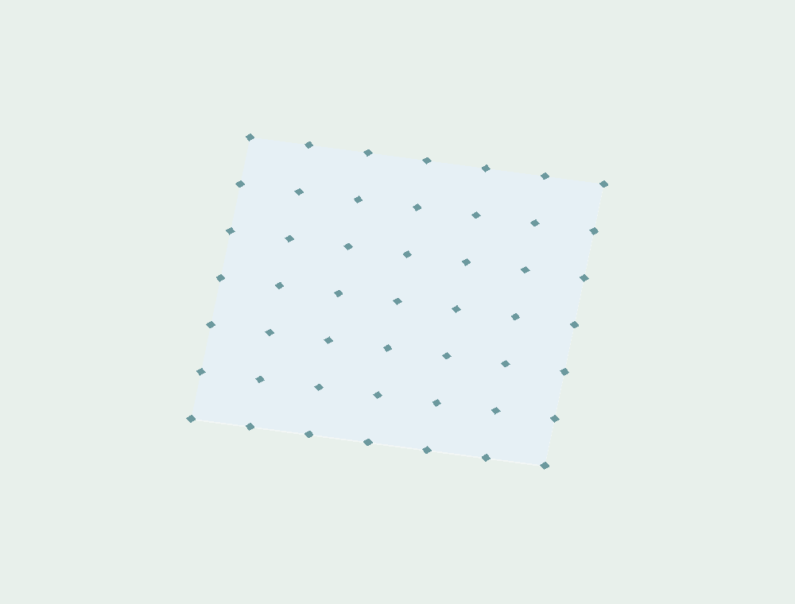

> 최신 엔진 개선: [연결된 면 묶음 뒤집기](CONNECTED_PACKET_FOLDING.md). 목·꼬리 끝부분의 연속 뒤집기까지 13회 접기를 검증했습니다. 머리의 중첩 뒤집기와 최종 학 완성은 아직 남아 있습니다.

> 최신 조작: [격자 없는 자유점 선택과 공통 모아 접기](FREE_POINTS_AND_GATHER.md). 일반 클릭, 수평·수직 보정, 4점 추가와 겹 선택을 검증했습니다. 5개 도안은 아직 완성하지 못했습니다.

> 최신 진행: [꽃잎 접기 개선과 종이학 재시도](PETAL_FOLDING.md). 앞뒤 꽃잎과 가장자리 좁히기까지 진행했으며, 종이학은 목·꼬리의 다겹 뒤집기에서 아직 미완성입니다. 아래는 앞선 주머니 접기 검증 기록입니다.

# 주머니 벌리기·눌러 펴기 공통 시스템 보강

2026-11-10 · Unity 6000.5.3f1 · 한 변 13점 · 예비 접기 생략

## 적용 결과

**종이학의 앞쪽 주머니와 뒤쪽 주머니를 모두 눌러 펴서 사각 기본형을 만들었다.** 이전에는 눌렀을 때 삼각형으로 돌아갔다. 이번에는 사각형의 실제 꼭짓점 좌표, 종이 면적, 고정된 겹, 저장 재생까지 확인했다.

물폭탄·점프 개구리·종이학·백합·드래곤 v2도 다시 실행했다. **다섯 작품을 완성한 것은 아니다.** 종이학은 다음 꽃잎 접기에서, 다른 작품은 아래 단계에서 여전히 막힌다. 주머니 성공과 작품 완성을 구분한다.

## 공통 엔진에서 바꾼 내용

- 네 점이 지정한 중앙 접힘선과 양옆 접힘선의 실제 면 연결 관계를 찾는다. 양옆 면 내부에 접힘이 있고 중앙이 접혀 있는 주머니에만 새 계산을 사용한다. 단순히 책장처럼 벌리는 조작은 기존 방식으로 유지한다.
- 중앙 접힘선의 벌어짐과 주변 강체 면의 길이 제약을 함께 푼다. 공유 경계가 고정된 겹에서 떨어지지 않도록 한다.
- 완전히 겹친 출발 자세에서는 고정된 겹을 뚫는 방향 대신 지지 접힘선을 기준으로 벌어지는 방향으로 계산을 시작한다. 고정 면 접촉과 최종 면 교차 검사는 유지한다.
- 처음에는 주머니를 벌리고, 이후에는 실제로 연결된 고정 지지선을 축으로 눌러 편다. 관계없는 고정 종이 꼭짓점은 그 축을 정하는 데 사용하지 않는다.
- 겹친 평면에서 시작하는 주머니는 종이 중심면 계산과 두께 배치를 분리한다. 닫히는 순간 각도 계산이 불안정해지는 문제는 평면 거리 제약으로 해결하고, 면적·변 길이·평면성 검사를 통과한 경우에만 확정한다.
- 위쪽/아래쪽 주머니의 겹 순서를 따로 보존한다. 기존 저장은 `coupledHinges=false`로 이전 계산 경로를 유지하며 새 4점 조작에만 해당 정보를 저장한다.
- 일정한 내부 계산 간격을 사용해 마우스 입력 간격, 중간 각도 되돌림, 저장 재생의 결과가 달라지지 않도록 했다.

런타임에는 작품 이름·도안 전용 좌표·완성 메시가 없다. 도안 좌표는 Editor 검증 도구에만 있다. 순수 기하 계산은 계산 클래스에, 선택/드래그/수정은 기존 FoldingDesk FSM에 유지했다.

접힘선 각도와 면의 길이를 함께 다루는 접근은 [Origami Simulator의 공개 설명](https://amandaghassaei.com/projects/origami_simulator/)도 참고했다. 외부 시뮬레이터 코드나 라이브러리를 프로젝트에 복사한 것은 아니다.

## 조작

기존과 동일하게 **움직일 점 → 중심점 → 양옆 점**을 고른다. 다른 겹의 네 번째 점은 `Tab`으로 찾아 선택할 수 있다.

면을 드래그하거나 슬라이더를 움직이면 주머니 벌리기에서 눌러 펴기로 이어진다. 이 경우 UI는 실제 한 접힘선의 각도로 오해하지 않도록 벌리기/눌러 펴기의 진행률로 표시한다. 중간에 놓았다면 `E`로 마지막 접기를 다시 조절하고, `C`로 밀착까지 진행할 수 있다. `Esc` 수정 취소와 `Z` 되돌리기도 검사했다.

## 5개 도안 재실행

모두 동일한 런타임 엔진으로 연속 이동 → 확정 → 레시피 재생 → 메시 렌더를 수행했다. 아래 다섯 제작 경로는 엔진 API 검사다. 실제 마우스/키보드 입력 검사는 별도의 주머니 시나리오로 수행했다. 다섯 작품을 UI로 완주했다는 뜻은 아니다.

| 도안 | 이번 결과 | 현재 막힌 곳 |
|---|---|---|
| [물폭탄](https://origami.me/waterbomb/) | 첫쪽 135도 변형 후 반대쪽 약 2.178도까지. 2회 확정. | 웹 3단계. 아직 평평한 종이의 양쪽을 함께 모아 삼각 베이스를 만드는 작업이 막힌다. 이 경로는 이미 접힌 주머니가 아니므로 새 계산을 강제로 적용하지 않는다. |
| [점프 개구리](https://www.japansociety.org.uk/usercontent/3bc1ed5a28641e243974254376c82e51/Jumping-Frog-Origami-Instructions.pdf) | 반 접기 뒤 상단 네 점으로 주머니 변형을 약 179.990도까지 진행. 2회 확정. | PDF 5단계. 움직임은 확대됐지만 머리의 평평한 삼각형 형상과 아래 몸통 보존을 함께 충족하지 못했다. 다음 다리/몸통 접기는 진행하지 않았다. |
| [종이학](https://californiamuseum.org/wp-content/uploads/CAM_Uprooted_CraneInsturctions.pdf) | 실제 두 번의 반 접기 → 앞 주머니 180도 눌러 펴기 → 뒤 주머니 -180도 눌러 펴기. **PDF 6단계의 사각 기본형 성공**, 총 4회 확정. | PDF 9~10단계 꽃잎 접기. 예비 접기 7~8단계는 생략. 현재 격자에서 선택 가능한 점으로 시도한 근사 경로가 약 0.195도에서 제한됐다. 원본 각 이등분선과 정확히 같은 좌표는 아니므로 모든 꽃잎 접기 경로가 불가능하다고 단정하지 않는다. |
| [백합](https://www.origami-fun.com/support-files/origami-lily-print.pdf) | 첫쪽 135도 후 반대쪽 약 2.930도까지. 2회 확정. | PDF 3단계 베이스. 물폭탄처럼 새 접힘들을 함께 만들어 모으는 단계가 남았다. 꽃잎 단계 미실행. |
| [드래곤 v2](https://origami.me/dragon-advanced/) | 웹 3·5·6단계 접기 3회 후 7단계 시도. | 선택한 앞쪽 날개를 들어 올리는 경로의 허용 이동이 0도다. 이 경우 새 주머니 구조 조건을 만족하지 않아 기존 연결 면 제약에 막힌다. |

확정 횟수에는 부분 각도도 포함되며, 통과한 원본 도안 단계 수와 같지 않다. 원문의 드래곤 v2는 Low-Intermediate이고 자료 간 공통 난이도 척도는 없다.

### 실제 중간 모양

- [이전 종이학: 삼각형으로 돌아간 상태](results-fourpoint/crane-stopped.png)
- [실제 입력: 주머니 벌리는 중](input-pocket/pocket-open.png)
- [실제 입력: 눌러 편 뒤](input-pocket/pocket-flat.png)
- [E로 다시 조절한 뒤 C로 밀착](input-pocket/resumed-flat.png)
- 이번 [물폭탄](results-pocket/waterbomb-stopped.png), [개구리](results-pocket/frog-stopped.png), [백합](results-pocket/lily-stopped.png), [드래곤](results-pocket/dragon-stopped.png)

모두 실제 FoldMesh 렌더이며 완성품 목업이 아니다.

## 검증 근거

- 방향 4가지 × 양옆 점 선택 순서 2가지 = **8가지**에서 앞/뒤 주머니, 정확한 사각 기본형 좌표, 고정 겹 유지, 면적, 소수 각도 및 역방향 조절, JSON 저장 재생, 되돌리기 통과.
- 기존 **12가지** 4점 간격/위아래 겹/양옆 순서 검사와 4겹 중 한 겹만 접기, 접촉, 연결부, 저장 재생 검사 통과.
- 실제 InputSystem 마우스·키보드로 네 점 선택, 겹 전환, 벌리기와 눌러 펴기, 중간 확정, E 재수정, Esc 취소, C 밀착, Z 되돌리기 통과.
- 기존 면/꼭짓점 드래그, 120도 한 겹 접기, 다른 겹에 걸친 네 점으로 단순 벌리기 입력도 회귀검사 통과.
- 사각 겹 주머니와 부분 머리 주머니의 다른 경로도 별도로 시험했다. [추가 시도 로그](unity-four-system-pocket-shapes-seed.log)에 성공/제한 각도가 모두 있다. 제한된 후보를 성공으로 바꾸지 않았다.
- CPU/GC Profiler 검증이나 모든 접기 모양에 대한 보증은 아니다. 특히 복잡한 여러 지지선/새 접힘 생성은 아직 제한된다.

[최종 엔진/5종 로그](unity-four-system-pocket-audit-final.log) · [주머니 실제 입력 로그](unity-four-system-pocket-input-final.log) · [기존 입력 회귀 로그](unity-four-system-pocket-legacy-input.log) · [5종 레시피와 단계별 결과](results-pocket/results.json) · [적용 소스 해시](source-manifest.json)

Unity 메뉴 `Tools > FlyEditor > Validation > Pocket folding`에서 새 공통 검사를 실행할 수 있다. `Origami feasibility audit`는 다섯 도안을 다시 실행한다. 배치 진입점은 `FlyEditor.Editor.PocketFoldingVerification.Run`, `OrigamiFeasibilityAudit.Run`이다.

## 남은 공통 문제

1. 아직 접혀 있지 않은 종이에 여러 새 접힘선을 만들어 양쪽을 함께 모으는 베이스 접기.
2. 여러 고정 경계에 연결된 부분 주머니를 눌러 펴기.
3. 새로운 각 이등분선과 면 분할이 필요한 꽃잎 접기. 현재 13점 입력과 실제 필요한 접힘 위치 사이의 차이도 해결해야 한다.
4. 주머니와 다른 연결 구조를 가진 날개 들기·뒤집기.

이번 개선은 이 문제들을 도안 전용 예외로 우회하지 않았다. 예비 접기를 다시 요구하는 방식도 추가하지 않았다.

이전 결과는 [4점 공통 개선 보고서](2026-11-10-fourpoint-baseline.md), [직접 변형 후보 보고서](2026-11-10-direct-baseline.md), [예비 접기 포함 최초 보고서](2026-11-10-precrease-baseline.md)에 보존했다.
