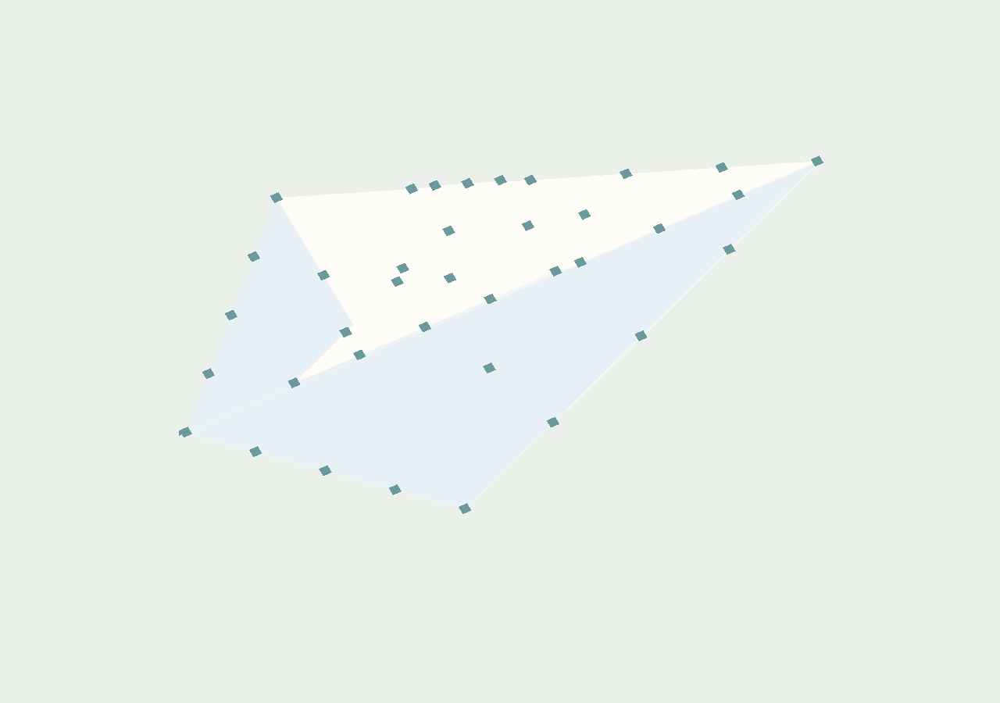

# 한 장 종이 백합 연구 — 미완성

현재 결과는 백합 완성품이 아닙니다. 정사각형 한 장에서 기본형과 네 주머니를 만들고, 첫 꽃잎을 올렸다가 내렸습니다. 이번에는 주변 겹을 기존 축으로 정리한 뒤 **두 번째 꽃잎까지 끝까지 들어 올렸습니다.** 준비 회전 3회와 꽃잎 접기를 한 번의 드래그·되돌리기로 묶어 저장 레시피는 **22개 작업**입니다. 개별 동작으로 펼치면 25개입니다. 나머지 두 꽃잎, 밑부분 좁히기와 최종 입체 전개는 아직 완료하지 않았습니다.

## 도안

[Tuttle Publishing — Traditional Lily / Iris, Intermediate Level](https://www.tuttlepublishing.com/content/docs/OrigamiContest/Origami_Folding_Instructions_Lily_MEDIUM.pdf)

한 장으로 만드는 전통 백합이며 출판사 표기는 중급입니다. 주머니를 누르는 접기와 여러 꽃잎을 연속으로 만드는 부분이 현재 엔진에 까다로워 연구 대상으로 골랐습니다. 접었다 펴서 표시만 만드는 예비 접기는 생략했습니다. 원본 PDF와 도안 이미지는 저장소에 재배포하지 않습니다.

## Unity에서 확인

1. Main 씬을 Play하고 비행 준비 상태로 둡니다.
2. `Tools > FlyEditor > Validation > Open lily study - INCOMPLETE (Play Mode)`를 선택합니다.
3. 작업대에 `partial.json`의 22개 작업를 재생합니다. 연구용 미완성 상태입니다.

메뉴는 비행기 저장 데이터를 자동으로 교체하지 않습니다. 작업대에서 사용자가 기체 적용을 선택하는 것은 별도 동작입니다. 실제 Play Mode에서 열기, 22개 작업 재생, 렌더링, 적용 없이 닫기, 기존 기체와 연구 포인트 유지까지 검사했습니다.

## 공통 엔진 보완

- 서로 다른 재료상의 점이 같은 위치에 포개진 닫힌 주머니를 네 점으로 눌러 펴는 기하 계산을 추가했습니다.
- 안쪽 반환 면이 자유 꼭짓점까지 닿지 않는 꽃잎 접기의 짧은 반환 면을 계산합니다.
- 접힌 면이 닫히기 직전의 위치로 겹의 위아래 순서를 계산합니다.
- 새 회전은 중립면으로 충돌을 검사해 힌지의 두께 오프셋 때문에 약 0.2도에서 정지하던 경우를 분리합니다. 출발 시 다른 겹에 막힌 방향의 차단은 유지합니다.
- 부분 회전 후 같은 평면으로 돌아온 면을 공통 좌표계로 정리합니다. 뒤집힌 방향으로 닫히는 경우도 포함합니다.

후속 엔진 개선에서 새 작업대의 개별 영역 네 점 접기에 `connectedPetalBacking`, `partialPetalBacking`을 연결했고, 새 두 점 접기와 기존 힌지 벌리기에 `neutralContacts`를 연결했습니다. 새 네 점 입력에도 `exactSquash`를 연결했습니다. 두 점을 찍고 **양옆 점 찾기**를 누르면 겹쳐 보이는 주머니의 보조점을 구분해 제안합니다. 제안만으로 접기가 확정되지는 않습니다. 기존 저장 레시피는 기존 계산으로 재생됩니다. 자세한 적용 범위와 검사는 [연결된 반환 면 개선 기록](../engine-continuity-v2/README.md)을 참고하세요. 형상 계산에 백합 이름이나 도안의 고정 좌표를 넣지 않았습니다.

## 검증 결과

- 22개 작업: 저장·재생, 되돌리기, 면적 보존, 모든 재료 접합부 검사 통과.
- 주머니/꽃잎 중간 자세 222개, 일반 회전 중간 자세 15개 통과.
- 반대 방향이 고정된 겹에 막히는 3개 조건의 차단 유지.
- 기존 안쪽 접기, 중첩 접기, 꽃잎, 주머니, 네 점 접기, 겹 벌리기, 비행기 도안 등의 회귀 검사 통과.
- 실제 플레이 모드 메뉴와 작업대의 예제 재생 및 기존 진행도 보존 통과.

`Tools > FlyEditor > Validation > Lily study check (incomplete)`에서 연구용 레시피 검사를 다시 실행할 수 있습니다. 결과 요약은 `validation.txt`에 있습니다. 이 검사는 모든 두께 충돌이나 모든 종이접기의 실현 가능성을 증명하지 않으며, 실시간 성능 측정도 포함하지 않습니다.

조작 보조와 이번 진행 과정은 [양옆 점 찾기 검증 기록](../fold-assist/README.md)을 참고하세요. 이전 19회 상태도 해당 폴더의 `before-19.json`에 보존했습니다.

## 이번 공통 보조 동작

두 점을 찍고 **양옆 점 찾기**를 누르면 주변 겹을 정리할 경로도 자동으로 찾습니다. 경로가 준비되면 기존처럼 드래그하고 놓습니다. 중간 상태도 저장하고 E로 수정할 수 있으며, Z 한 번으로 준비 과정까지 되돌립니다. 계산은 별도 종이 사본에서 진행하며 Esc나 닫기로 취소할 수 있습니다.

[주변 겹 정리 설계·검증 기록](../petal-clearance/README.md)에 공통 계산, 상태 전이, 저장, 실제 입력 검사와 한계를 정리했습니다. 이전 21개 작업은 `../petal-clearance/before-21.json`에 원본 그대로 보존했습니다.

## 아직 막히는 구간

충돌 없이 열 수 있는 꽃잎 순서로 진행해 두 번째 꽃잎을 완성했습니다. 다른 꽃잎의 일부 방향은 제한된 탐색에서 아직 경로를 찾지 못했습니다. 자동 보조는 선택된 주머니 축의 기존 힌지에 대해 최대 3회 준비 회전과 192개 상태를 검사합니다. 모든 겹 구성이나 모든 꽃잎 순서를 해결하는 범용 물리 솔버는 아닙니다.

나머지 두 꽃잎, 밑부분 좁히기와 최종 꽃 모양의 연속 완성을 더 검증해야 합니다. 충돌 차단을 끄거나 완성 메시를 주입하지 않았습니다.
