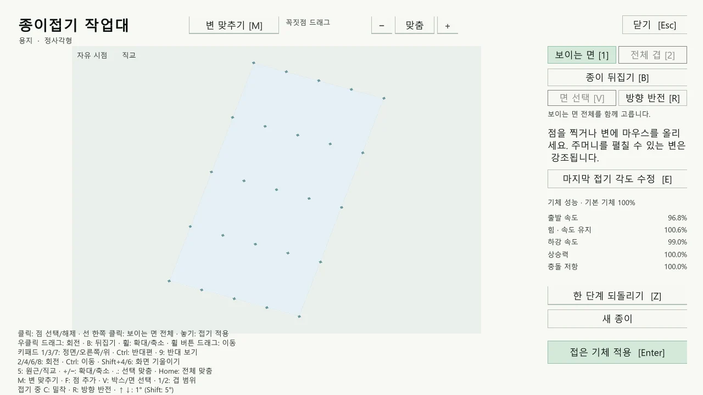

# FlyEditor

**직접 접은 종이 기체를 발사하고, 착륙 보상을 연구에 투자하며 다시 비행하는 게임입니다.**

1인 개발 중 · 종이 접기·비행·연구 · Unity 6000.5.3f1 · C#

[Windows 실행 파일](https://github.com/lde0707/portfolio-game-builds/releases/tag/flyeditor-2026-11-14) · [QA 엑셀](https://leedoeon.vercel.app/qa/reports/flyeditor.xlsx) · [QA 포트폴리오](https://leedoeon.vercel.app/qa/index.html)

## 내가 맡은 역할

접기·비행·연구 시스템 구현과 테스트를 담당하고 있습니다.

## 게임의 주요 흐름

발사·비행 → 착륙 보상 → 연구 구매 → 접기·재실행

## 실행 방법

### Unity 없이 플레이

1. 위 **Windows 실행 파일** 링크에서 `FlyEditor-Windows-x64.zip`을 받습니다.
2. ZIP **전체를 압축 해제**합니다.
3. `FlyEditor.exe`를 실행합니다.

Windows 64비트용입니다. EXE와 `Data` 폴더·`UnityPlayer.dll`을 함께 유지하세요. GitHub의 `Source code` 압축 파일은 게임 실행 패키지가 아닙니다.

**기본 조작:** 마우스로 접기 선·면 선택 / C 접기 / Z 되돌리기 / Enter 적용 / 화면 UI로 발사·연구

Unity에서 소스 열기

1. Unity Hub에서 `FlyEditor` 폴더를 프로젝트로 추가합니다.
2. **Unity 6000.5.3f1**으로 엽니다.
3. `Assets/_Project/Scenes/Main.unity` 씬을 열고 Play를 실행합니다.
4. 실행 파일을 만들 때 Windows Build Support를 설치하고 기존 Build Settings의 씬 구성으로 Windows x64를 빌드합니다.

## QA 테스트

Windows 빌드에 실제 키보드·마우스 입력을 보내 확인한 내용입니다. 세부 조건과 관찰값은 **QA 엑셀의 플레이 재검증 시트**에서 볼 수 있습니다.

| 확인 기능 | 테스트 조건 | 관찰 결과 |
|---|---|---|
| 비행·연구 | 비행·착륙 후 비용 30 연구 구매 | 보상 59 지급 후 구매 잔액 29 |
| 접기·되돌리기 | 선·면 선택 후 C, Z, 다시 접기·적용 | 접기 기록 1 → 0 → 1과 형상 적용 |
| 종료·재실행 | 연구 구매·접기 적용 후 재실행 | 연구점 29·접힌 형상 유지, 기체 발사 확인 |

**검증 범위:** 모든 접기 조합·연구 노드·비행 조건을 검증한 결과는 아닙니다.

[실제 입력 검증 기록](PLAYTEST.md) · [실행·검증 안내](PLAY.md)

## 소스와 상세 문서

- [접기 작업대](FlyEditor/Assets/_Project/Scripts/Runtime/Gameplay/Flight/FoldingDesk.cs)
- [게임 코드](FlyEditor/Assets/_Project/Scripts/Runtime)
- [기존 개발·설계 기록](README-DEV-NOTES.md)
